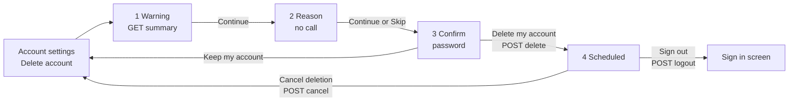

# Delete Account: FE Guide

Date: 2026-11-03. For: the mobile app team, and whoever writes the words on
these screens.
Screens: the 4 Figma frames "Delete Account - Warning", "Delete Account -
Reason", "Delete Account - Confirm" and "Delete Account - Scheduled".

A customer deletes their account in 4 screens. Nothing is removed at once:
the account is **scheduled** for deletion 30 days later, and until then it
works as normal, so the customer can sign in and cancel. On day 30 the
server cancels their upcoming bookings and deletes the account.

This guide is how to wire each screen: which call, which field goes where,
every answer and every error, and which words in the Figma need a small
change to stay true.

**Status:** `POST /auth/me/delete` and `POST /auth/me/delete/cancel` are live
today. `GET /auth/me/delete/summary` and the new `confirmation_sent_to`
field arrive with the next customer-api deploy. Build against this guide
now; the server team will tell you when the deploy is done.

---

## 0. Read this first

1. **Base URL:** `https://api.gostyle.uk/api/v1`. Every call here needs
   `Authorization: Bearer <app login token>`. No token, or an expired one, is
   `401`.
2. **4 calls in total:** `GET /auth/me/delete/summary` (screen 1),
   `POST /auth/me/delete` (screen 3), `POST /auth/me/delete/cancel`
   (screen 4), and the `GET /auth/me` you already call.
3. **Screens 1 and 2 change nothing.** Only the red "Delete my account"
   button on screen 3 schedules the deletion.
4. **The 30 days come from the server.** Use `purge_after_days` from the
   summary and `purge_at` from the delete answer. Never hard-code 30 or work
   the date out yourself after the delete call.
5. **Show only the rows the server sends.** There is no wallet, no saved
   card, no discount card, no points and no gallery in the system yet.
   Hide those rows from the Figma (section 2).
6. **Signing in does NOT cancel the deletion.** The customer must tap
   "Cancel deletion". After every sign-in, read `purge_at` on `/auth/me` and
   show screen 4 when it is set (section 6).
7. **Errors keep this API's usual shape:** `{detail, code, errors: [{field,
   code, message}]}`. A field error is `422`, never `400`.

---

## 1. The flow at a glance



| Screen | When it opens | Call | What you show from it |
| ------ | ------------- | ---- | --------------------- |
| 1 Warning | "Delete account" tapped | `GET /auth/me/delete/summary` | The "you will lose" rows, the 30 days |
| 2 Reason | Continue on screen 1 | none | Keep the picked reason in memory |
| 3 Confirm | Continue or Skip on screen 2 | `POST /auth/me/delete` on the red button | The email line (from `/auth/me`) |
| 4 Scheduled | The delete answered `200` | `POST /auth/me/delete/cancel` on "Cancel deletion" | `purge_at`, `confirmation_sent_to` from the delete answer |

---

## 2. Screen 1: Warning

### The call

```
GET /api/v1/auth/me/delete/summary
Authorization: Bearer <token>
```

`200`:

```json
{
  "purge_after_days": 30,
  "purge_at": null,
  "upcoming_bookings": 2,
  "favourites": 5
}
```

| Field | Type | Meaning |
| ----- | ---- | ------- |
| `purge_after_days` | int | The countdown, 30. Use it in "This starts a 30-day countdown". |
| `purge_at` | ISO date-time or `null` | Already scheduled? Then it holds the date. Normally `null` here. |
| `upcoming_bookings` | int or `null` | The same number as the Upcoming tab's badge. `null` means "could not count right now", not zero. |
| `favourites` | int | Saved salons plus saved stylists. They are removed too. |

If `purge_at` is **not** null, the deletion is already scheduled: skip the
flow and open screen 4 with that date.

### The rows, Figma against the API

| Figma row | Show it? | How |
| --------- | -------- | --- |
| "AED 1,200.00 wallet credit / Spend it before you go..." | **No, hide it** | There is no wallet in the system. |
| "2,840 points and Gold Member status" | **No, hide it** | No loyalty points in the app yet. (`points` and `tier_level` on `/auth/me` are placeholders, do not use them here.) |
| "2 payment cards and 1 discount card" | **No, hide it** | No cards are saved. |
| "Upcoming bookings and your gallery / Bookings are cancelled. 24 gallery items are removed." | **Yes, without the gallery** | Title "Upcoming bookings". Small text from `upcoming_bookings` (wording in section 8). |
| (not in Figma) saved salons and stylists | Optional | From `favourites`, if design wants a row. Hide it when `0`. |

`upcoming_bookings`:

- `> 0`: "Your 2 upcoming bookings are cancelled."
- `0`: hide the row, or "No upcoming bookings." (design's choice).
- `null`: "Upcoming bookings are cancelled." with no number.

### The checkbox and Continue

"I understand I'll lose these." is app-only. Continue stays disabled until
it is ticked. Continue makes no call.

### Errors

| Status | When | Do |
| ------ | ---- | -- |
| `401` | Token missing or expired | Refresh the token and retry, as everywhere. |

A slow or down booking server is **not** an error here: you still get `200`,
with `upcoming_bookings: null`.

---

## 3. Screen 2: Reason

No call on this screen. Keep the choice and send it with the delete on
screen 3.

| Figma label | Send `reason` |
| ----------- | ------------- |
| I don't use Go Style anymore | `not_using` |
| I have a privacy concern | `privacy` |
| Too many notifications | `too_many_notifications` |
| I'm switching to another app | `found_alternative` |
| Something else | `other` |

- **Skip**, or Continue with nothing picked: send **no** `reason` key at all.
- The API also knows `bad_experience`. It is not in the Figma, so the app
  does not use it.
- The API accepts an optional `note` (free text, up to 1000 characters). The
  Figma has no text box, so do not send it.

---

## 4. Screen 3: Confirm

### Before the call: the email line

The box "We'll email kevin.new@gmail.com to confirm..." comes from
`/auth/me`, which the app already has:

- Show it only when `email` is set **and** `email_verified_at` is not null.
  That is the server's own rule: it emails only a verified address.
- Otherwise hide the whole box. No email will be sent, so the screen must not
  promise one.
- The date in that sentence: today + `purge_after_days`, in the phone's time
  zone, written like "21 Nov 2026". (The exact date comes back in the answer.)

### The call (red "Delete my account" button)

```
POST /api/v1/auth/me/delete
Authorization: Bearer <token>
Content-Type: application/json

{
  "password": "the password typed on this screen",
  "reason": "too_many_notifications"
}
```

`password` is required. `reason` is optional (section 3).

`200`:

```json
{
  "purge_at": "2026-12-03T10:50:24.888744Z",
  "confirmation_sent_to": "kevin.new@gmail.com"
}
```

| Field | Meaning |
| ----- | ------- |
| `purge_at` | When the account will be deleted, in UTC. Show it in the phone's time zone. |
| `confirmation_sent_to` | The address the confirmation email went to, or `null` when none was sent (no verified email). |

Then open screen 4 with these two values.

### Errors

| Status | `errors[0].field` | `errors[0].code` | When | Do |
| ------ | ----------------- | ---------------- | ---- | -- |
| `403` | `password` | `wrong_password` | The password is wrong | Red text under the field: "Wrong password." Stay on the screen. |
| `422` | `password` | `required` | No password sent | The button should be disabled until something is typed. |
| `422` | `reason` | `invalid_choice` | A reason the API does not know | An app bug: check the table in section 3. |
| `401` | | `not_authenticated` | Token missing or expired | Refresh the token and retry. |

Example, wrong password:

```json
{
  "detail": "You do not have permission to do that.",
  "code": "permission_denied",
  "errors": [
    {"field": "password", "code": "wrong_password", "message": "Wrong password."}
  ]
}
```

Example, unknown reason:

```json
{
  "detail": "Please correct the highlighted fields.",
  "code": "validation_error",
  "errors": [
    {"field": "reason", "code": "invalid_choice", "message": "\"bored\" is not a valid choice."}
  ]
}
```

### "Keep my account"

No call. Close the flow and go back to account settings.

### Pressing the button twice

Safe. A second delete while one is scheduled keeps the **first** date and
answers the same `purge_at`. Still, disable the button while the call runs.

---

## 5. Screen 4: Scheduled

### What goes where

| Figma | From |
| ----- | ---- |
| "Deletion date: 21 Nov 2026" | `purge_at`, in the phone's time zone, as "d MMM yyyy" |
| "Confirmation sent to: kevin.new@gmail.com" | `confirmation_sent_to`. **Hide the row when it is `null`.** |

When this screen opens from a sign-in (section 6) or from settings, you have
no delete answer: take `purge_at` from `/auth/me`, and for the email row use
the same rule as screen 3 (`email` set and `email_verified_at` not null).

### "Cancel deletion"

```
POST /api/v1/auth/me/delete/cancel
Authorization: Bearer <token>
```

`204`, no body. The deletion is cancelled and the account stays as it was,
with all its bookings. If the account has a verified email, the server sends
"Your account will not be deleted". Then go back to account settings, and
show a short message such as "Your account will not be deleted."

Safe to call when nothing is scheduled: it still answers `204`.

### "Sign out"

Your normal sign out (`POST /auth/logout`), then the sign-in screen. The
deletion stays scheduled.

### Back arrow

Back to account settings. The deletion stays scheduled.

---

## 6. While a deletion is scheduled

For the 30 days the account works as normal: the customer can sign in,
browse and even book. So:

- **After every sign-in**, and when the app opens with a saved session,
  read `/auth/me`. When `purge_at` is not null, show screen 4 (or a banner
  that opens it) so the customer sees the date and can tap
  "Cancel deletion".
- In account settings, while `purge_at` is not null, show "Deletion
  scheduled for 21 Nov 2026" with a "Cancel deletion" button instead of
  "Delete account".
- `deleted_at` on `/auth/me` is always `null` for a signed-in customer. You
  can ignore it.

---

## 7. What happens on day 30

The server does this; the app does nothing. It is here so the app and the
help texts can explain it truthfully.

1. **Upcoming bookings are cancelled**, exactly as if the customer had
   tapped Cancel on each one: the same refund rules, the same late-cancel
   rule inside 24 hours. A routine is ended as a whole.
   - A party the customer **booked** is cancelled for everyone in it, as the
     party's Cancel button does.
   - A place in **someone else's** party is not cancelled: that booking
     belongs to the person who booked it.
2. **The account is deleted:** name, phone, email, photo, date of birth,
   saved salons and stylists, devices, sign-in sessions, notifications and
   2-step verification are removed. The phone number and email can be used
   to register a new account.
3. **One last email** "Your account has been deleted" goes to the verified
   email, if there was one.
4. **Every token stops working.** Any call answers `401`; send the customer
   to the sign-in screen as you do for any `401`. Signing in with the old
   phone and password answers "Invalid credentials."

The server runs this once an hour, so it happens within an hour after
`purge_at`.

---

## 8. Words on the screens

The Figma words that stay, and the few that need a change to be true.

| Screen | Figma text | Use |
| ------ | ---------- | --- |
| 1 | "This starts a 30-day countdown. Until it ends, you can sign back in to cancel." | Keep. Take 30 from `purge_after_days`. |
| 1 | Wallet, points, cards rows | Remove (section 2). |
| 1 | "Upcoming bookings and your gallery" | "Upcoming bookings" |
| 1 | "Bookings are cancelled. 24 gallery items are removed." | "Your 2 upcoming bookings are cancelled." (section 2 for 0 and unknown) |
| 1 | "I understand I'll lose these." | Keep. |
| 2 | "Why are you leaving? Optional. It helps us improve." and the 5 reasons | Keep. |
| 3 | "Enter your password to schedule deletion." | Keep. |
| 3 | "We'll email kevin.new@gmail.com to confirm. Your account is deleted on 21 Nov 2026 unless you sign back in before then." | "We'll email kevin.new@gmail.com to confirm. Your account is deleted on 21 Nov 2026 unless you sign back in **and cancel** before then." Hide the box with no verified email. |
| 4 | "Sign in any time before the date below to keep your account." | "Sign in any time before the date below **and tap Cancel deletion** to keep your account." |
| 4 | "Deletion date", "Confirmation sent to" | Keep. Hide "Confirmation sent to" when `confirmation_sent_to` is `null`. |

Why the two "and cancel" changes: signing in alone does not stop the
deletion. Only "Cancel deletion" does. That way someone who learns the
password cannot quietly undo a customer's deletion just by signing in.

The emails the customer gets (sent by the server, for reference):

| When | Subject |
| ---- | ------- |
| Deletion scheduled | Go Style: your account is scheduled for deletion |
| Deletion cancelled | Go Style: your account will not be deleted |
| Day 30, deleted | Go Style: your account has been deleted |

---

## 9. Test checklist

1. Screen 1 shows only the Upcoming bookings row (and favourites, if
   designed). With booking-api slow, it still opens, without a number.
2. Screen 1 with a deletion already scheduled jumps to screen 4.
3. Skip on screen 2 sends no `reason`. Each of the 5 reasons sends its code.
4. Wrong password: "Wrong password." under the field, nothing scheduled.
5. Right password: screen 4 with the date 30 days ahead, in local time.
6. Account with no verified email: no email box on screen 3, no "Confirmation
   sent to" row on screen 4.
7. Cancel deletion: `204`, back to settings, `/auth/me` shows `purge_at: null`.
8. Delete, sign out, sign in again: screen 4 (or the banner) appears.
9. Delete twice: the same date both times.
