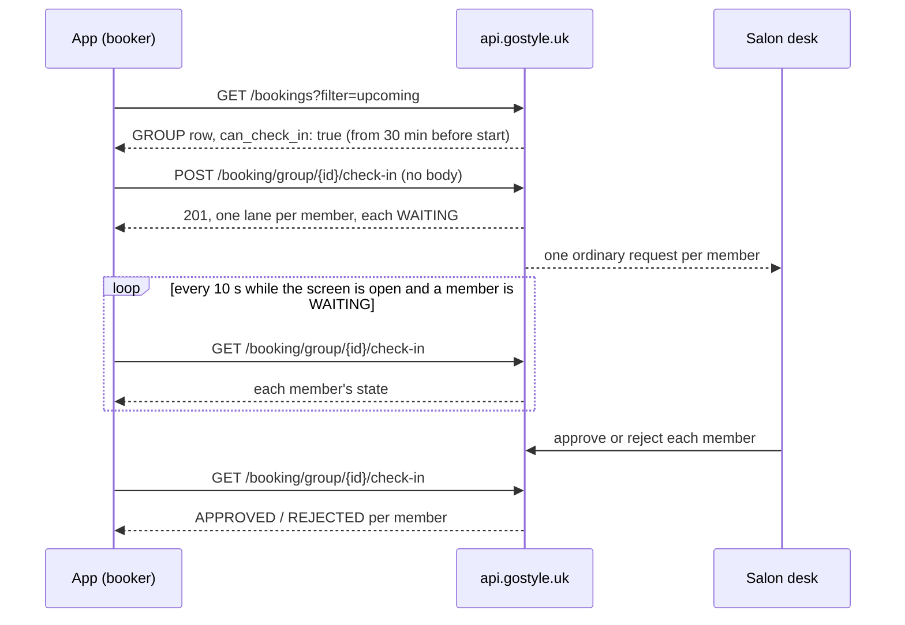

# Mobile Group Check-in ("We are here"): FE Guide

Date: 2026-10-14. For: the mobile app team.
Server code: customer-api `main` 3a8c7d6, booking-api `main` 46907d2. Tested end
to end on 2026-10-14 (§13).

The booker of a party arrives at the salon and taps **We are here** once. The
desk gets the ordinary check-in request for **each member** of the party, and
approves or rejects each one, exactly as it does for one booking. Approving a
member checks that member in.

This guide is for **parties** (`GROUP` rows) only. One booking's "I am here"
is in `docs/MOBILE_SELF_CHECK_IN_FE.md` (the single guide). This guide reuses
its `CheckInRequest` type (single guide §4) and its request states (single
guide §6).

**Everything here is behind the server switch `GROUP_CHECK_IN_V1`, and it is
OFF on production today.** Until it is on, both routes answer `404` and no
party row offers the button. Build against this guide; the server team turns
the switch on (§12).

---

## 0. Read this first

1. **Base URL:** `https://api.gostyle.uk/api/v1`. Every path below is relative to it.
2. **Auth:** `Authorization: Bearer <app login token>` on every call. Only the **booker** of the party may use these routes. Everyone else gets `404`.
3. **The button comes from the server.** Show **We are here** only when the `GROUP` row's `can_check_in` is `true` (§3). Never work the rule out in the app.
4. **One tap, no body: everyone.** That is the whole v1 feature. (`booking_ids` exists, but do not build "pick members" in v1: §5.2.)
5. **Answers are `camelCase`** (`groupId`, `bookingId`, `memberKind`). They are booking-api's own, passed through as they came, like the single check-in. The My Bookings row stays `snake_case`.
6. **No chair scan for a party.** Every member is "Wait for Staff". Never send `chair_token`: it is a `422`.
7. **Sending it again is always safe.** Members already waiting stay waiting; nobody gets a second request. Retry freely after a `503` or a lost connection.
8. **Each member's request is the same object as one booking's** (`CheckInRequest`), with the same states: `WAITING`, `APPROVED`, `REJECTED`, `EXPIRED`, `CLOSED`, `WITHDRAWN`.

---

## 1. Endpoints at a glance

| Method | Path | What it does |
| ------ | ---- | ------------ |
| `POST` | `/booking/group/{group_id}/check-in` | We are here: ask the desk to check in my party |
| `GET`  | `/booking/group/{group_id}/check-in` | Each member's latest answer |

`{group_id}` is the `GROUP` row's `id` from My Bookings: the same id that
`GET /booking/{id}` and `POST /booking/{id}/cancel` take for a party.

`POST /booking/{id}/check-in` (the single route) does **not** take a party's id.
It answers `404` for it.

---

## 2. The flow



1. The booker opens My Bookings. From 30 minutes before the party's start, its `GROUP` row has `can_check_in: true`.
2. They tap **We are here**: `POST /booking/group/{group_id}/check-in`, no body. Answer: `201`, one line per member, each `WAITING`.
3. The app shows "The salon knows your party is here", one line per member, and reads `GET /booking/group/{group_id}/check-in` every 10 seconds while the screen is open (§6).
4. The desk answers each member on its own. Each line moves to `APPROVED` (checked in) or `REJECTED` (speak to the desk).
5. When no member is `WAITING` any more, stop reading. Refresh My Bookings.

Members who have the app (registered friends) see the party on their own My
Bookings, **with no button**. Guests have no app. The booker does it for
everyone.

---

## 3. When to show "We are here"

Read these fields on the `GROUP` row of `GET /bookings?filter=upcoming`:

| Field | On a `GROUP` row |
| ----- | ---------------- |
| `can_check_in` | **The button.** `true` only on the **booker's** row, while the party is `CONFIRMED_BY_SALON`, from 30 minutes before `start_time` until `end_time`. Always `false` on a member's row. |
| `check_in_opens_at` | When the button opens, in UTC (`"2026-10-14T04:42:00.000Z"`). Show it in the salon's time: "Check-in opens at {time}." `null` on a member's row, and when the party is not `CONFIRMED_BY_SALON`. |
| `can_scan_chair` | Always `false`. A party has no Scan the chair, even when chair scanning is on for single bookings. |
| `is_booker` | `true` on the booker's row, `false` on a member's. Use it only to draw the member's view (§8.3). The button is `can_check_in`. |

A real booker's row (trimmed), 10 minutes before the start, from the test run (§13):

```json
{
  "id": "65a6eeed-f3ac-41d4-8e85-ce24becfcdff",
  "booking_type": "GROUP",
  "status": "CONFIRMED_BY_SALON",
  "payment_status": "PAY_AFTER_CHECK_IN",
  "member_count": 3,
  "start_time": "2026-10-14T11:12:00+06:00",
  "end_time": "2026-10-14T12:12:00+06:00",
  "is_booker": true,
  "can_check_in": true,
  "check_in_opens_at": "2026-10-14T04:42:00.000Z",
  "can_scan_chair": false
}
```

The same party on a member's My Bookings: `"is_booker": false`,
`"can_check_in": false`, `"check_in_opens_at": null`, `"can_scan_chair": false`.

**Treat a missing key as `false`** (or `null` for `check_in_opens_at`). While a
switch is off, some of these keys are not there at all (§12).

Things to know:

- **The window.** `start_time` is when the party starts (everyone in an app party starts together). `end_time` is when the last member finishes. The button is on from 30 minutes before `start_time` until `end_time`.
- **The row is a snapshot.** Refresh My Bookings when the app comes back to the foreground, so a party that was 40 minutes away gets its button once `check_in_opens_at` passes. The server checks everything again on the tap anyway.
- **The row follows the booker's own booking.** The row's `status` is the booker's own. Once the desk checks the booker in (by approving the request, or by scanning the party pass, which is the booker's code), the row says `CHECKED_IN` and `can_check_in` is `false`, even if other members are not in yet. With the v1 tap (no body, everyone is asked at once) this does not matter. If the desk scans the party pass before anyone taps, the party is already at the desk, and the desk checks the others in by hand. It is also the reason not to build "pick members" yet (§5.2).
- **The party screen (`GET /booking/{group_id}`) does not carry these fields today.** It has no `can_check_in`, `check_in_opens_at` or `is_booker`. Take them from the My Bookings row: pass the row's values into the party screen, and refresh My Bookings when that screen comes to the foreground. (If the server adds them to the party read later, this guide will say so.)

---

## 4. TypeScript types (copy these)

`CheckInRequest`, `CheckInState` and `BookingApiError` are the single guide's
(§4). They are not repeated here.

```ts
import type { CheckInRequest, BookingApiError } from './self-check-in'; // single guide §4

// Who a member is.
export type GroupMemberKind =
  | 'self'        // the booker (the signed-in user)
  | 'registered'  // a friend with an account
  | 'guest';      // a name only, no account

// What happened to ONE member when the booker tapped We are here.
export type GroupLaneOutcome =
  | 'RAISED'      // asked the desk now
  | 'WAITING'     // already asked before, still waiting: nothing new
  | 'CHECKED_IN'  // already in (checked in, in service, or done)
  | 'LEFT'        // no longer a visit today (cancelled, no-show, moved)
  | 'REFUSED';    // cannot be checked in now: see `error`

// One member in the POST answer (and in details.lanes of the 409).
export interface GroupCheckInLane {
  bookingId: string;               // this member's own booking id
  bookingCode: string;             // "GS-1403": the same as members[].booking_code on the party read (§7)
  memberKind: GroupMemberKind;
  outcome: GroupLaneOutcome;
  request: CheckInRequest | null;  // set only for RAISED and WAITING
  error: BookingApiError | null;   // set only for REFUSED: the single check-in's own error
}

// POST answer, 201 and 200.
export interface GroupCheckInAnswer {
  groupId: string;
  lanes: GroupCheckInLane[];       // one per member, in party order
}

// One member in the GET answer.
export interface GroupCheckInReadLane {
  bookingId: string;
  bookingCode: string;
  memberKind: GroupMemberKind;
  request: CheckInRequest | null;  // this member's latest request; null: never asked
}

// GET answer, 200.
export interface GroupCheckInRead {
  groupId: string;
  lanes: GroupCheckInReadLane[];
}

// POST body. Leave it out in v1 (§5).
export interface RaiseGroupCheckInBody {
  booking_ids?: string[];          // snake_case: customer-api's own field
}

// 409 when nothing could be done for anyone, for mixed reasons (§5.4).
export interface GroupCheckInNone extends Omit<BookingApiError, 'details'> {
  code: 'BOOKING_GROUP_CHECKIN_NONE';
  details: { groupId: string; lanes: GroupCheckInLane[] };
}

// The My Bookings GROUP row gains these (snake_case, as the rest of the row).
export interface GroupRowCheckIn {
  can_check_in: boolean;
  check_in_opens_at?: string | null;  // UTC ISO
  can_scan_chair?: boolean;           // always false on a GROUP row
  is_booker?: boolean;
}
```

---

## 5. We are here: `POST /booking/group/{group_id}/check-in`

### 5.1 The body

**v1: send no body.** The token only. Everyone in the party is asked.

| You send | What happens |
| -------- | ------------ |
| no body | Every member. **Use this.** |
| `{"booking_ids": []}` | Every member (an empty list is the same as no list). |
| `{"booking_ids": ["<bookingId>", ...]}` | Only those members (§5.2). |
| `{"chair_token": null}` | Accepted; the `null` is ignored. |
| `chair_token` with any value but `null` | `422`, field `chair_token`. Nothing is asked. |
| `booking_ids` that is not a list of strings, or a body that is not a JSON object | `422`, field `booking_ids`. Nothing is asked. |

### 5.2 `booking_ids`: only some members (not for v1)

Each id is a member's `bookingId` from a lane of this party (from the `GET` or
an earlier `POST`). It is **not** `members[].id` on the party read, which is a
different id (§7). An id that is not a member of this party is a `422` (field
`bookingIds`, code `not_found`), and **nothing is asked for anyone**.

Why not in v1: the button follows the booker's own booking (§3). If the booker
asks only for themselves, the desk checks them in, and the row's button goes
away before the rest of the party was asked. The route itself would still work,
but the app would have no server button left to show for it.

### 5.3 The answer

**`201 Created`**: at least one member was asked now. The first tap for a party of three, from the test run (test booking codes; real ones look like `GS-1403`):

```json
{
  "groupId": "65a6eeed-f3ac-41d4-8e85-ce24becfcdff",
  "lanes": [
    {
      "bookingId": "5324c082-ea06-4f62-ac15-4770b2410244",
      "bookingCode": "GS-A1-110218",
      "memberKind": "self",
      "outcome": "RAISED",
      "request": {
        "requestId": "01a138ca-3ac1-74a0-bfee-27f7bae688f8",
        "bookingId": "5324c082-ea06-4f62-ac15-4770b2410244",
        "state": "WAITING",
        "raisedAt": "2026-10-14T05:02:19.837Z",
        "decidedAt": null,
        "chair": null
      },
      "error": null
    },
    {
      "bookingId": "c359b174-a885-4bee-973c-f8659da15ca7",
      "bookingCode": "GS-A2-110218",
      "memberKind": "registered",
      "outcome": "RAISED",
      "request": {
        "requestId": "01a138ca-3ae9-73b2-8578-be6da25d9328",
        "bookingId": "c359b174-a885-4bee-973c-f8659da15ca7",
        "state": "WAITING",
        "raisedAt": "2026-10-14T05:02:19.876Z",
        "decidedAt": null,
        "chair": null
      },
      "error": null
    },
    {
      "bookingId": "849eff00-fc29-4612-ae83-f6fabd35c6de",
      "bookingCode": "GS-A3-110218",
      "memberKind": "guest",
      "outcome": "RAISED",
      "request": {
        "requestId": "01a138ca-3aec-725d-b5ec-7683c47f3782",
        "bookingId": "849eff00-fc29-4612-ae83-f6fabd35c6de",
        "state": "WAITING",
        "raisedAt": "2026-10-14T05:02:19.876Z",
        "decidedAt": null,
        "chair": null
      },
      "error": null
    }
  ]
}
```

**`200 OK`**: nothing new, but at least one member is already waiting (a
second tap, or a tap after the app was closed). Same shape; those members say
`WAITING` with the same `requestId` as before. **Treat `200` and `201` the
same.**

One lane per member, in party order. Find the booker by `memberKind: "self"`,
not by position.

| `outcome` | What happened | `request` | `error` | Show on the member's line |
| --------- | ------------- | --------- | ------- | ------------------------- |
| `RAISED` | Asked the desk now | the request, `WAITING` | `null` | "Waiting for the desk" |
| `WAITING` | Already asked before | the request, `WAITING` | `null` | "Waiting for the desk" |
| `CHECKED_IN` | Already in | `null` | `null` | "Checked in" |
| `LEFT` | Not a visit today any more (cancelled, no-show) | `null` | `null` | Leave the member out |
| `REFUSED` | This member cannot be checked in now | `null` | the single check-in's own error | `error.message`, or your own words per `error.code` (§9) |

**A member refused does not stop the others.** The others are still asked.

When a member is `REFUSED` in practice (everyone in an app party starts
together, so a member is never "too early" on their own):

- `BOOKING_CHECKIN_REJECTED`: the desk said no to this member before. They speak to the desk. There is no second try (§10).
- `BOOKING_CHECKIN_WINDOW` with `details.windowClosed: true`: this member's own service has already ended (a short service, and a late tap).
- `BOOKING_STATE_INVALID` with `details.status`: this member's booking is not confirmed for another reason.

### 5.4 Nothing to do: `409`

When **nobody** could be asked and nobody is waiting, the answer is a `409`.
There are two kinds.

**a) Every member refused for the same reason.** The answer is that reason,
exactly as one booking says it, so the app reads it the same way. Everyone too
early:

```json
{
  "statusCode": 409,
  "code": "BOOKING_CHECKIN_WINDOW",
  "message": "Check-in opens at 2026-10-14T05:32:00.000Z.",
  "details": { "windowOpensAt": "2026-10-14T05:32:00.000Z" },
  "error": "Conflict"
}
```

Show "Check-in opens at {time}" (`details.windowOpensAt`, in the salon's time).
The party is over: `"message": "Check-in for this booking has closed."`,
`"details": { "windowClosed": true }`.

**b) Mixed reasons: `BOOKING_GROUP_CHECKIN_NONE`.** For example two members
already in and one rejected, or everyone already in, or everyone cancelled.
`details.lanes` holds every member, in the same lane shape as the `201`. Draw
the member lines from it.

```json
{
  "statusCode": 409,
  "code": "BOOKING_GROUP_CHECKIN_NONE",
  "message": "Nothing could be checked in for this party.",
  "details": {
    "groupId": "65a6eeed-f3ac-41d4-8e85-ce24becfcdff",
    "lanes": [
      { "bookingId": "5324c082-...", "bookingCode": "GS-A1-110218", "memberKind": "self",
        "outcome": "CHECKED_IN", "request": null, "error": null },
      { "bookingId": "c359b174-...", "bookingCode": "GS-A2-110218", "memberKind": "registered",
        "outcome": "CHECKED_IN", "request": null, "error": null },
      { "bookingId": "849eff00-...", "bookingCode": "GS-A3-110218", "memberKind": "guest",
        "outcome": "REFUSED", "request": null,
        "error": {
          "statusCode": 409,
          "code": "BOOKING_CHECKIN_REJECTED",
          "message": "The desk could not confirm your arrival. Please speak to the desk.",
          "error": "Conflict"
        } }
    ]
  },
  "error": "Conflict"
}
```

---

## 6. Read the answers: `GET /booking/group/{group_id}/check-in`

**`200 OK`**: every member with their **latest** request, or `null` if they
were never asked. From the test run, after the desk approved two members and
rejected one:

```json
{
  "groupId": "65a6eeed-f3ac-41d4-8e85-ce24becfcdff",
  "lanes": [
    {
      "bookingId": "5324c082-ea06-4f62-ac15-4770b2410244",
      "bookingCode": "GS-A1-110218",
      "memberKind": "self",
      "request": {
        "requestId": "01a138ca-3ac1-74a0-bfee-27f7bae688f8",
        "bookingId": "5324c082-ea06-4f62-ac15-4770b2410244",
        "state": "APPROVED",
        "raisedAt": "2026-10-14T05:02:19.837Z",
        "decidedAt": "2026-10-14T05:02:20.097Z",
        "chair": null
      }
    },
    {
      "bookingId": "c359b174-a885-4bee-973c-f8659da15ca7",
      "bookingCode": "GS-A2-110218",
      "memberKind": "registered",
      "request": {
        "requestId": "01a138ca-3ae9-73b2-8578-be6da25d9328",
        "bookingId": "c359b174-a885-4bee-973c-f8659da15ca7",
        "state": "APPROVED",
        "raisedAt": "2026-10-14T05:02:19.876Z",
        "decidedAt": "2026-10-14T05:02:20.188Z",
        "chair": null
      }
    },
    {
      "bookingId": "849eff00-fc29-4612-ae83-f6fabd35c6de",
      "bookingCode": "GS-A3-110218",
      "memberKind": "guest",
      "request": {
        "requestId": "01a138ca-3aec-725d-b5ec-7683c47f3782",
        "bookingId": "849eff00-fc29-4612-ae83-f6fabd35c6de",
        "state": "REJECTED",
        "raisedAt": "2026-10-14T05:02:19.876Z",
        "decidedAt": "2026-10-14T05:02:20.164Z",
        "chair": null
      }
    }
  ]
}
```

Each member's line, by `request.state`:

| `request` | Show on the member's line |
| --------- | ------------------------- |
| `null` | Not asked yet. (Before the tap, every member is `null`.) |
| `WAITING` | "Waiting for the desk" |
| `APPROVED` | "Checked in" |
| `REJECTED` | "Please speak to the desk." This member cannot be asked again. |
| `EXPIRED` | "The salon did not answer in time. Please speak to the desk." |
| `CLOSED` | The booking moved on another way (the desk checked them in with its own button, or it was cancelled). Show the member as the party read now says (§7). |
| `WITHDRAWN` | Not offered for parties in v1 (§10). If seen, treat as `null`. |

The desk's reason for a rejection is never sent to the app. Use your own words.

**Reading while the party waits:**

- Read once when the party's check-in screen opens, to draw the right state.
- While the screen is open and **any** member is `WAITING`, read every **10 seconds**.
- Stop when no member is `WAITING`, or when the screen closes.
- There is **no push** when the desk answers (yet).
- After the party (or a member) is cancelled or checked in another way, a `WAITING` request can stay `WAITING` for up to about a minute, then turns `CLOSED`. The same as one booking.

There is **no welcome object** (`checkIn`, single guide §14) in this read. For
the booker's own welcome, read `GET /booking/{bookingId}/check-in` with the
booker's own `bookingId` (the lane with `memberKind: "self"`). The same call on
another member's `bookingId` is `404`: it is not the booker's booking.

---

## 7. The party screen: matching members

The party read, `GET /booking/{group_id}`, has `members[]` with each member's
`name`, `kind`, `status` and `booking_code`. The check-in lanes have
`bookingCode`. **Match them by code:**

```ts
const lineFor = (m: PartyMember) =>
  read.lanes.find((l) => l.bookingCode === m.booking_code);
```

- `members[].id` is **not** a booking id. Never send it as `booking_ids`, and never match it to `bookingId`.
- As the desk approves each member, that member's `members[].status` moves to `CHECKED_IN` on the party read too. A rejected member stays `CONFIRMED_BY_SALON`.
- Names: take them from `members[].name` (a guest's name is there too). The lanes carry no names.

---

## 8. What the app shows

### 8.1 The booker, before the tap

| Row says | Show |
| -------- | ---- |
| `can_check_in: true` | **We are here** |
| `can_check_in: false`, `check_in_opens_at` in the future | "Check-in opens at {time}" (salon time). No button. Refresh then. |
| `can_check_in: false`, `check_in_opens_at` in the past | The window has closed. No button. |
| `can_check_in: false`, `check_in_opens_at: null` | No button, no text. |
| `status: CHECKED_IN` | The party is in (the booker at least). Show the party read's members (§7). |

### 8.2 The booker, after the tap

- `201` or `200`: one line per member from `lanes` (§5.3), names from the party read (§7). Then read every 10 seconds (§6).
- `409` with one shared reason (§5.4 a): show it as for one booking, for example "Check-in opens at {time}".
- `409 BOOKING_GROUP_CHECKIN_NONE` (§5.4 b): draw the member lines from `details.lanes`. Usually "Everyone is already checked in."
- When every line is final (`APPROVED`, `REJECTED`, `EXPIRED`, `CLOSED`): stop reading, refresh My Bookings.
- A member `REJECTED`: that member speaks to the desk. The others go on as normal.

### 8.3 A member (not the booker)

The row has `is_booker: false` and `can_check_in: false`. Show the party as
usual, with something like "{booker's name} checks in the party when you
arrive." Do **not** call the group check-in routes: they answer `404` to
anyone but the booker.

---

## 9. Errors

Two shapes, as in the single guide (§8):

- **Shape A**, the envelope `{detail, code, errors[]}`: `401`, `404`, `422`, `503`.
- **Shape B**, booking-api's `{statusCode, code, message, details?, error}`: every `409`, and every lane's `error`.

**Switch on the HTTP status first, then on `code`.** Every `404` means the same
thing to the app: hide the button.

| Status | Shape and `code` | When | What the app does |
| ------ | ---------------- | ---- | ----------------- |
| `201` / `200` | (the answer) | At least one member asked / one already waiting | §8.2 |
| `409` | B, `BOOKING_GROUP_CHECKIN_NONE`, `details.lanes` | Nothing to do, mixed reasons | Draw the lines from `details.lanes` |
| `409` | B, `BOOKING_CHECKIN_WINDOW`, `details.windowOpensAt` | Everyone too early | "Check-in opens at {time}." |
| `409` | B, `BOOKING_CHECKIN_WINDOW`, `details.windowClosed` | Everyone's visit has ended | "Check-in for this party has closed." |
| `409` | B, `BOOKING_CHECKIN_REJECTED` | The desk said no to every member before | "Please speak to the desk." |
| `409` | B, `BOOKING_STATE_INVALID`, `details.status` | Every member's booking is not confirmed, for one same reason | Refresh My Bookings |
| `422` | A, `validation_error`, `errors[0].field: "chair_token"` | A `chair_token` was sent | App bug: never send it |
| `422` | A, `validation_error`, `errors[0].field: "booking_ids"` | Not a list of strings, or not a JSON object | App bug: send no body |
| `422` | A, `validation_error`, `errors[0].field: "bookingIds"`, `errors[0].code: "not_found"` | An id that is not a member of this party. Nothing was asked. | Read the `GET` again and use its `bookingId`s |
| `404` | A, `not_found`, `errors[0].field: "id"`, "No such booking." | Not the booker, or no such party | Hide the button |
| `404` | A, `not_found`, `errors[0].field: null`, "Not found" | The switch is off (customer-api) | Hide the button |
| `404` | B, `BOOKING_NOT_FOUND`, "Cannot POST ..." | The switch is off (booking-api) | Hide the button |
| `404` | no JSON body | The id in the path is not a uuid | Never happens if you use the row's `id` |
| `401` | A, `not_authenticated` | No token, or it expired | Refresh the token, as everywhere |
| `503` | A, `code: "service_unavailable"`, `errors[0].code: "booking_api_unavailable"` | Booking is down | "Something went wrong on our side. Please try again in a moment." Safe to send again. |

Real bodies:

```json
// 404, not the booker (a member's own token on the booker's party)
{"detail":"Please correct the highlighted fields.","code":"not_found",
 "errors":[{"field":"id","code":"not_found","message":"No such booking."}]}

// 422, chair_token sent
{"detail":"Please correct the highlighted fields.","code":"validation_error",
 "errors":[{"field":"chair_token","code":"invalid",
   "message":"A party is checked in without a chair. Tap We are here, and the desk checks each member in."}]}

// 422, an id that is not a member of this party
{"detail":"Please correct the highlighted fields.","code":"validation_error",
 "errors":[{"field":"bookingIds","code":"not_found",
   "message":"Not a booking of this party: 991034c8-4baf-46ac-92e6-1d37ecded632"}]}

// 503, booking-api unreachable
{"detail":"Booking is temporarily unavailable. Please try again.","code":"service_unavailable",
 "errors":[{"field":null,"code":"booking_api_unavailable",
   "message":"Booking is temporarily unavailable. Please try again."}]}
```

---

## 10. Not in v1

- **Scan the chair for a party.** Every member is Wait for Staff.
- **Cancel Request for a party.** There is no party route for it. Do not offer it. (The single `POST /booking/{bookingId}/check-in/withdraw` works on the booker's own `bookingId` only; on any other member's it is `404`. Do not build on that.)
- **A second try after a rejection.** A `REJECTED` member speaks to the desk.
- **Members checking themselves in from their own app.** Only the booker's tap.
- **A welcome per member** (`checkIn`): only the booker's own, §6.
- **A push when the desk answers.** Read it (§6).

---

## 11. Times

- `check_in_opens_at`, `raisedAt`, `decidedAt` and `details.windowOpensAt` are UTC (`...Z`). Show them in the salon's time zone.
- `start_time` and `end_time` carry an offset. Compare instants, never the clock text: two screens can write the same instant with two offsets.

---

## 12. Rollout

The feature needs five switches, all on: customer-api `SELF_CHECK_IN_V1` and
`GROUP_CHECK_IN_V1`; booking-api `SELF_CHECK_IN_V1`, `MOBILE_GROUP_BOOKING` and
`MOBILE_GROUP_CHECK_IN`.

**Production today (2026-10-14):** the code is deployed, single self check-in
is on, `GROUP_CHECK_IN_V1` is **off**. So both party routes answer `404`
("Not found"), and every `GROUP` row has `can_check_in: false` and
`check_in_opens_at: null`.

What the app sees while a switch is off (each one tested, §13):

| Off | `GROUP` row | Both routes |
| --- | ----------- | ----------- |
| customer-api `GROUP_CHECK_IN_V1` | `can_check_in: false`, `check_in_opens_at: null`, `can_scan_chair: false` (`is_booker` may still be there) | `404`, shape A, "Not found" |
| customer-api `SELF_CHECK_IN_V1` | `can_check_in: false`, no `check_in_opens_at`, no `can_scan_chair` | `404`, shape A, "Not found" |
| booking-api `MOBILE_GROUP_CHECK_IN` | no `is_booker`, `can_check_in: false`, `check_in_opens_at: null` | `404`, shape B, `BOOKING_NOT_FOUND` |
| booking-api `MOBILE_GROUP_BOOKING` | no `GROUP` rows at all | `404`, shape B, `BOOKING_NOT_FOUND` |

In every case: no button, and a tap would be a harmless `404`. The app needs no
switch of its own.

---

## 13. How this was tested (2026-10-14)

All four services on one machine (platform, booking-api `main`, customer-api
`main`, customer-api's sign-in gRPC), every switch on. Each party was seeded in
booking-api's database in the shape the app's create writes. **Every call went
through a real door**: the customer's through customer-api, as the app; the
desk's through booking-api, as the business web.

- **66 of 66 checks passed:** the button (booker on, member off, no chair); all refusals before booking-api is called; who may (member `404`, no token `401`, unknown party `404`); raise one, raise all, raise again (`200`), empty list; the desk's list (one request per member), approve, reject; the reads; nothing-to-do `409`s (mixed, all too early, all over); a mixed party (raised, refused, left); withdraw and raise again; the button after the booker is in.
- **Every switch off**, one at a time: the table in §12.
- **Five taps at the same moment:** one `201`, four `200`, exactly one request per member.
- **booking-api down:** `503 booking_api_unavailable` on both routes.
- **Cancelled while waiting:** the requests turned `CLOSED` within a minute.
- **Unit tests:** booking-api 3358 passed; customer-api 1361 passed.

---

## 14. QA checklist

- [ ] Booker, 10 minutes before the start: **We are here** shows. A member's row: no button, `is_booker: false`.
- [ ] 40 minutes before: no button; "Check-in opens at {time}" from `check_in_opens_at`. After that time and a refresh, the button shows.
- [ ] Tap: `201`, every member `WAITING`; the desk sees one request per member.
- [ ] Tap again: `200`, the same `requestId`s, nothing new at the desk.
- [ ] The desk approves everyone: every line `APPROVED`; the party read's members are `CHECKED_IN`; the row says `CHECKED_IN` with no button.
- [ ] The desk rejects one member: that line says "Please speak to the desk"; the others go on.
- [ ] Tap once more after everyone answered: `409 BOOKING_GROUP_CHECKIN_NONE`, lines from `details.lanes`.
- [ ] Everyone too early (called anyway): `409 BOOKING_CHECKIN_WINDOW` with `windowOpensAt`.
- [ ] A member's own token on the route: `404`. The app never calls it for a member.
- [ ] No Scan the chair on a party, even where single bookings have it.
- [ ] Airplane mode during the tap, then tap again: no duplicate at the desk.
- [ ] Switch off on the server: no button on any `GROUP` row, and the route is `404`.
