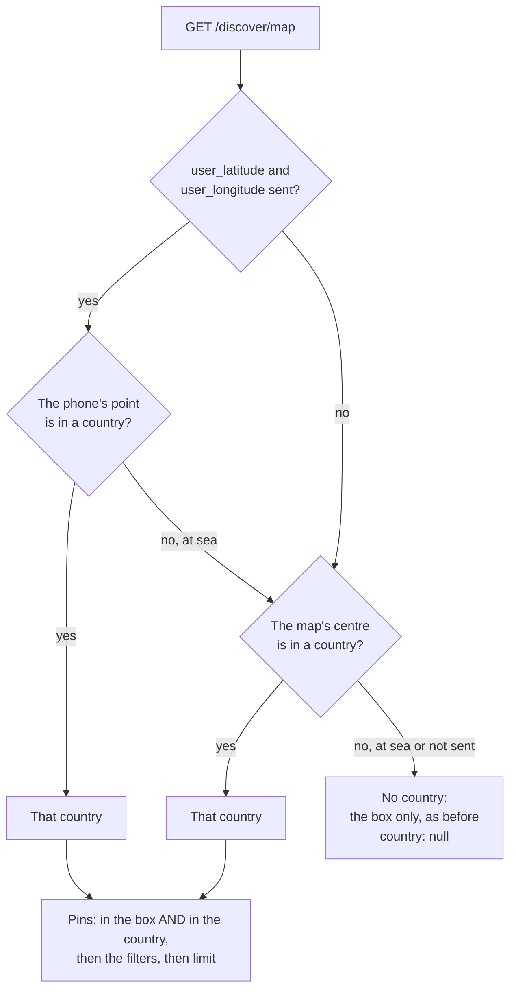

# Mobile Map, the Customer's Country Only: FE Guide

Date: 2026-11-03. For: the mobile app team.
Screen: the map on the home tab (`src/app/(tabs)/index.tsx`).

The map now shows salons from one country only: the country the customer's
phone is in. This guide is how to wire it, step by step: the two new params,
the new `country` field, and the two empty-map messages.

Your request is kept as `docs/map-country-fe-contract.md`. The
field-by-field reference is `docs/MAP_COUNTRY_API.md`. The Filters drawer is
`docs/MAP_FILTERS_API.md`, and nothing in it changes. This guide follows all
three.

**LIVE since 2026-11-03** (server switch `MAP_COUNTRY_V1` is on).

---

## 0. Read this first

1. **Base URL:** `https://api.gostyle.uk/api/v1`. One endpoint:
   `GET /discover/map`, the one the map already calls.
2. **Auth is optional**, as today. Send `Authorization: Bearer <app login token>`
   when the customer is signed in, nothing when not. A bad or expired token is
   `401`: refresh it and retry, or retry without it.
3. **Two new params: `user_latitude` and `user_longitude`.** The phone's own
   GPS fix, **rounded to 2 decimals**, **both or neither**.
4. **Never the map's centre.** The map's centre is `latitude` and `longitude`,
   as today. `user_*` is only ever the phone. No fix: leave both out.
5. **Send them on every map call while you have a fix**, however far the map
   has moved. Every other param stays exactly as today, the filters too.
6. **One new field: `country`.** Use it only for the empty-map messages (§7).
   Draw the pins from `venues`, as today.
7. **The server already removed the other countries.** Never filter the pins
   by country in the app.
8. **Nothing found is never an error:** `200` with `"count": 0` and `country`
   filled in.

---

## 1. What changes at a glance

| | Before | Now |
| - | ------ | --- |
| Request | `latitude`, `longitude`, both deltas, `zoom`, `limit`, `category`, the filters | The same, **plus** `user_latitude`, `user_longitude` when you have a fix |
| Pins (`venues`) | Every salon in the box, any country | Salons in the box **and** in the customer's country |
| `count` | As before | As before, counted inside that country only |
| New field | | `country: { code, name, has_salons }`, or `null` |
| Empty map | One plain empty map | Two cases: "not in view" and "not in this country yet" (§7) |

Your five cases, as the server answers them:

| The customer | Pins | `country` |
| ------------ | ---- | --------- |
| In Dubai, zoomed out over the Gulf | UAE salons only | `AE`, `has_salons: true` |
| In Dubai, pans the map to Muscat | none | `AE`, `has_salons: true` |
| In a country with no GoStyle salons | none | that country, `has_salons: false` |
| Phone in Riyadh, map opens on Dubai | Saudi salons only | `SA` |
| Location off, map opens on Dubai | UAE salons | `AE` (from the map's centre) |

---

## 2. How the server picks the country



- **"In a country"** means inside its borders, or, when no country holds the
  point, the nearest country within 25 km. That covers the coast, the marina,
  the beach and Palm Jumeirah.
- **With location on, the country is the phone's.** It stays the same however
  far the customer pans. Panning to another country shows an empty map.
- **With location off, the country is the map centre's.** It changes as the
  customer pans: drag the centre into Oman and you get Oman's salons.
- **`country: null`** happens only when there is no fix and the map's centre
  is out at sea. Then the server does what it did before: every salon in the
  box. Show the pins as they come, with no country message.

---

## 3. TypeScript types (copy these)

```ts
/** One pin: unchanged. */
type MapVenue = {
  id: string;                          // the salon's id, for GET /salon/{id}
  lat: number;
  lng: number;
  rating: number | null;               // 4.5; null when nobody reviewed it
  salon_profile_image: string | null;  // cover photo URL
};

/** NEW: the country the pins were limited to. */
type MapCountry = {
  code: string;        // ISO 3166-1 alpha-2, upper case: "AE", "BD", "OM"
  name: string;        // English: "United Arab Emirates", "Bangladesh"
  has_salons: boolean; // any live salon in the WHOLE country (box and filters ignored)
};

type MapResponse = {
  mode: "markers";     // always "markers" on this route
  count: number;
  venues: MapVenue[];
  /** null: no country (§2). Missing: only if the server switch is ever off (§12). */
  country?: MapCountry | null;
};

/** The phone's own fix, rounded to 2 decimals. Never the map's centre. */
type UserPosition = { latitude: number; longitude: number };

/** The map's visible region, as react-native-maps gives it. */
type MapRegion = {
  latitude: number;
  longitude: number;
  latitudeDelta: number;
  longitudeDelta: number;
};

/** The error envelope (400, 422 and the rest). */
type ApiError = {
  detail: string;
  code: string;
  errors: { field: string | null; code: string; message: string }[];
};
```

---

## 4. The phone's position

### 4.1 The rules

- **Only when you already have location permission.** This needs no new
  permission prompt. Permission off, GPS off, or a guest who declined: no
  `user_*` params, and the map uses its centre (§2).
- **Round to 2 decimals** (about 1 km) before it leaves the phone:
  `Math.round(value * 100) / 100`. That is enough for a country and keeps the
  exact position off the wire. The server rounds to 2 decimals too, so more
  decimals never change the answer.
- **Both or neither.** Keep them together in one object (`UserPosition`), so
  one can never be sent without the other.
- **Use a fresh fix.** A last-known fix from hours ago can be in the wrong
  country (the customer has flown from Dubai to Riyadh). Take the last-known
  one only when it is recent (10 minutes is a good limit), else ask for a new
  one at low accuracy.
- **Do not hold the map back for GPS.** If the fix is not there yet, call the
  map without `user_*`. When the fix arrives, the map calls again by itself
  (§8).
- **`origin_latitude` and `origin_longitude` do not change.** They are only
  for the `distance` filter. Keep filling them as today (the map's centre
  when there is no fix). Never use them for `user_*`.

### 4.2 Example (expo-location)

Your own location hook is fine. This only shows the rules.

```ts
import * as Location from "expo-location";

const round2 = (value: number) => Math.round(value * 100) / 100;

/** The phone's fix, rounded, or null. Never asks for permission itself. */
async function phonePosition(): Promise<UserPosition | null> {
  const { status } = await Location.getForegroundPermissionsAsync();
  if (status !== "granted") return null;

  const fix =
    (await Location.getLastKnownPositionAsync({ maxAge: 10 * 60 * 1000 })) ??
    (await Location.getCurrentPositionAsync({ accuracy: Location.Accuracy.Low }).catch(() => null));
  if (!fix) return null;

  return { latitude: round2(fix.coords.latitude), longitude: round2(fix.coords.longitude) };
}
```

Low accuracy is enough: a country does not need GPS precision, and it is
faster and lighter on the battery.

---

## 5. Building the map call

The same call as today, with the pair added when you have it.

```ts
const BASE = "https://api.gostyle.uk/api/v1";

type Params = Record<string, string | number | boolean | undefined>;

function mapUrl(
  region: MapRegion,
  zoom: number,
  filters: Params,              // the drawer's picks, exactly as today
  user: UserPosition | null,    // §4, or null
): string {
  const params: Params = {
    latitude: region.latitude,
    longitude: region.longitude,
    latitudeDelta: region.latitudeDelta,
    longitudeDelta: region.longitudeDelta,
    zoom,
    limit: 100,
    ...filters,
  };
  if (user) {
    params.user_latitude = user.latitude.toFixed(2);
    params.user_longitude = user.longitude.toFixed(2);
  }

  const q = new URLSearchParams();
  for (const [key, value] of Object.entries(params)) {
    if (value !== undefined && value !== "") q.set(key, String(value));
  }
  return `${BASE}/discover/map?${q}`;
}

async function getMap(fullUrl: string, token?: string, signal?: AbortSignal): Promise<MapResponse> {
  const res = await fetch(fullUrl, {
    headers: token ? { Authorization: `Bearer ${token}` } : {},
    signal,
  });
  if (!res.ok) {
    const body = (await res.json().catch(() => null)) as ApiError | null;
    throw Object.assign(new Error(`HTTP ${res.status}`), { status: res.status, body });
  }
  return res.json() as Promise<MapResponse>;
}
```

What the wire looks like:

```
GET /api/v1/discover/map?latitude=25.2048&longitude=55.2708&latitudeDelta=0.12
    &longitudeDelta=0.08&zoom=12&limit=100&user_latitude=25.20&user_longitude=55.27
```

With the drawer's filters too:

```
GET /api/v1/discover/map?latitude=25.2048&longitude=55.2708&latitudeDelta=0.12
    &longitudeDelta=0.08&zoom=12&limit=100&rating=4&additional=open_now
    &distance=10&origin_latitude=25.1972&origin_longitude=55.2744
    &user_latitude=25.20&user_longitude=55.27
```

The server works in this order: the country, then the box, then the filters,
then `limit`. So `limit` is never spent on a salon across the border.

---

## 6. Reading the answer

```json
{
  "mode": "markers",
  "count": 1,
  "venues": [
    {
      "id": "7dd88cda-9a17-4ac8-9f78-41c2903e23c8",
      "lat": 25.205047,
      "lng": 55.274148,
      "rating": null,
      "salon_profile_image": "https://entity-blob-storage.s3.eu-north-1.amazonaws.com/.../95pb503hrvw.jpg"
    }
  ],
  "country": {
    "code": "AE",
    "name": "United Arab Emirates",
    "has_salons": true
  }
}
```

| Field | What to do with it |
| ----- | ------------------ |
| `venues` | Draw the pins, as today. A tap opens `GET /salon/{id}`, as today. |
| `count` | As today. With a filter on, it is every match in view before `limit` (the filters guide, §2). |
| `country` | Only for the empty-map message (§7). Do not show it on a full map. |
| `country.has_salons` | Tells the two empty maps apart (§7). |

---

## 7. The empty map: which message

Only when `count` is `0`:

| `country` | `has_salons` | Filters on? | Show |
| --------- | ------------ | ----------- | ---- |
| object | `false` | either | **"GoStyle isn't in {country.name} yet."** |
| object | `true` | no | **"No salons in this area."** + "Back to my location" (with a fix) or "Zoom out" (without) |
| object | `true` | yes | **"No salons here match your filters."** + "Clear filters" and "Back to my location" (with a fix) |
| `null` | | either | Your plain empty map, as today. No country message. |
| missing | | either | As today (the switch is off, §12). |

`count` above `0`: just the pins, no message.

```ts
type MapMessage =
  | { kind: "not_here_yet"; countryName: string }
  | { kind: "nothing_in_view"; filtered: boolean; canGoBack: boolean }
  | null;

function mapMessage(res: MapResponse, filtersOn: boolean, user: UserPosition | null): MapMessage {
  if (res.count > 0 || !res.country) return null;
  if (!res.country.has_salons) {
    return { kind: "not_here_yet", countryName: res.country.name };
  }
  return { kind: "nothing_in_view", filtered: filtersOn, canGoBack: user !== null };
}
```

- **"Back to my location"** moves the map back to the phone, at your usual
  zoom. Use the phone's real fix for the camera: rounding is only for the
  request. After the move the map calls again, and the pins come back.
- **"Zoom out"**, when there is no fix, widens the region around the same
  centre. The country stays the centre's.
- **`has_salons` ignores the box and the filters.** So `false` means the whole
  country has no salon: "Clear filters" or "Zoom out" would not help. Show
  only the message.
- **The name is in English** ("United Arab Emirates", "Bangladesh", "Saudi
  Arabia"). For the app in another language, show your own name for
  `country.code`.

---

## 8. Panning, new fixes and refetching

- **Keep calling the map as today** when the region changes (with your
  debounce). Add the same `user_*` pair to every call.
- **Put the rounded pair in your cache key.** With React Query, for example:

  ```ts
  const key = ["discover-map", region, zoom, filters, user?.latitude ?? null, user?.longitude ?? null];
  ```

  Because the pair is rounded, moving a few hundred metres does not refetch.
  A real move (or the first fix arriving after the first load) does, once.
- **Drop old answers.** Abort the call in flight when a new one starts, or
  ignore an answer that is not for the latest key. An old answer from another
  country must never replace a new one.
- **On app foreground**, take a fresh fix (§4.1). If it rounds to a new
  pair, the key changes and the map refreshes.

---

## 9. Errors

| Status | When | What to do |
| ------ | ---- | ---------- |
| `200`, `count: 0` | Nothing in view, or nothing in the country | The message in §7 |
| `400` | A filter param the drawer does not offer (filters guide, §4) | A bug in the call: log it, load the map without filters |
| `401` | A bad or expired token | Refresh the token and retry, or retry without it |
| `422` | `user_*` wrong (below), or one of the map's own params | A bug in the call: log it **without the position**, and call again without `user_latitude` and `user_longitude` |
| `503` | Only with the `availability` filter (filters guide, §4) | Retry, or load the map without it |
| `5xx`, network | Server or network down | Keep the pins you have; show your error state |

`422` comes in the usual envelope, naming the param:

```json
{
  "detail": "Please correct the highlighted fields.",
  "code": "validation_error",
  "errors": [
    { "field": "user_longitude", "code": "invalid", "message": "Send user_latitude and user_longitude together." }
  ]
}
```

| `errors[0].field` | `message` | Cause |
| ----------------- | --------- | ----- |
| `user_longitude` | Send user_latitude and user_longitude together. | `user_latitude` sent alone |
| `user_latitude` | Send user_latitude and user_longitude together. | `user_longitude` sent alone |
| `user_latitude` | Must be 90 or less, got 91.0. (or "-90 or more") | Outside -90 to 90 |
| `user_longitude` | Must be 180 or less, got 181.0. (or "-180 or more") | Outside -180 to 180 |
| either | Expected a number, got 'undefined'. | Not a number (`"abc"`, `"undefined"`) |
| either | Expected a finite number, got 'NaN'. | `NaN` or `Infinity` |

The last two rows are the ones to watch: `String(NaN)` is `"NaN"` and
`String(undefined)` is `"undefined"`, and both are a `422`. An empty value
(`user_latitude=`) counts as not sent, so with the other one sent it is the
"together" error. Build the pair only from a real fix (§4).

---

## 10. Keep the position out of your logs

Your brief asks the server not to store or log the position. The server
rounds it, uses it to pick the country, and cuts both params out of its own
access logs. Please do the same on the phone:

- Do not put `user_latitude` or `user_longitude` in analytics events.
- Crash reporters and network tools often record the full request URL (for
  example Sentry's HTTP breadcrumbs). Cut the two params out before they are
  recorded:

  ```ts
  function withoutPosition(url: string): string {
    const [base, query = ""] = url.split("?");
    const kept = query.split("&").filter((p) => p && !/^user_(latitude|longitude)=/.test(p));
    return kept.length ? `${base}?${kept.join("&")}` : base;
  }

  // Sentry, for example:
  // beforeBreadcrumb(b) {
  //   if (b.data?.url) b.data.url = withoutPosition(b.data.url);
  //   return b;
  // }
  ```

---

## 11. Field notes

1. **`country.code` is ISO 3166-1 alpha-2, upper case** (`AE`, `BD`, `OM`,
   `SA`, `GB`). Compare codes, never names.
2. **`has_salons` is counted once a minute.** A salon that went live a
   moment ago can take up to a minute to turn it `true`.
3. **A salon's country comes from its map pin**, never its typed address, by
   the same borders as the customer. A new salon, or one that moved its pin,
   shows in its country within a minute.
4. **Borders are right to about 1 km on land.** A salon standing right on a
   land border could, rarely, count for the country next door. Al Ain is the
   UAE and Buraimi, next door, is Oman: both come out right.
5. **`country: null` means no country filter.** The pins are every salon in
   the box, as before, and can come from more than one country. It only
   happens with no fix and the map's centre out at sea.
6. **A phone more than 25 km out at sea** (a boat, a plane) counts as no fix:
   the map's centre decides.
7. **`mode` is always `"markers"`.** This route has no clusters.
8. **`limit` is capped at 500** by the server, as before.
9. **Older app builds** that do not send `user_*` get the map centre's
   country. They need no change to keep working.

---

## 12. Rollout: `MAP_COUNTRY_V1`

**On since 2026-11-03.** Nothing to wait for. You can send the pair from
your next build.

If the backend ever turns it off: the server ignores `user_latitude` and
`user_longitude` (even wrong ones, no `422`), and the answer has **no
`country` key**. Treat a missing key as "show the map as before": the pins,
and your plain empty map.

---

## 13. Try it

Live data on 2026-11-03: one salon in Dubai (NHL), three in Dhaka, none in
Oman or Saudi Arabia. The numbers change as salons join.

```sh
B='https://api.gostyle.uk/api/v1/discover/map?limit=100'

# In Dubai, map on Dubai: count 1 (NHL), country AE, has_salons true
curl -s "$B&latitude=25.2048&longitude=55.2708&latitudeDelta=0.5&longitudeDelta=0.5&user_latitude=25.20&user_longitude=55.27"

# In Dubai, panned to Muscat: count 0, country AE, has_salons true
curl -s "$B&latitude=23.5880&longitude=58.3829&latitudeDelta=0.5&longitudeDelta=0.5&user_latitude=25.20&user_longitude=55.27"

# One huge box over Dubai AND Dhaka, phone in Dubai: count 1, only NHL
curl -s "$B&latitude=24.5&longitude=72.8&latitudeDelta=6&longitudeDelta=40&user_latitude=25.20&user_longitude=55.27"

# The same box, phone in Dhaka: count 3, only the Dhaka salons, country BD
curl -s "$B&latitude=24.5&longitude=72.8&latitudeDelta=6&longitudeDelta=40&user_latitude=23.81&user_longitude=90.41"

# Phone in Muscat: count 0, country OM, has_salons false ("GoStyle isn't in Oman yet")
curl -s "$B&latitude=23.5880&longitude=58.3829&latitudeDelta=0.5&longitudeDelta=0.5&user_latitude=23.59&user_longitude=58.38"

# Phone in Riyadh, map on Dubai: count 0, country SA, has_salons false
curl -s "$B&latitude=25.2048&longitude=55.2708&latitudeDelta=0.5&longitudeDelta=0.5&user_latitude=24.71&user_longitude=46.68"

# Location off, map on Dhaka: count 3, country BD (from the centre)
curl -s "$B&latitude=23.78&longitude=90.38&latitudeDelta=0.5&longitudeDelta=0.5"

# Location off, centre out in the Gulf: country null, the box only (NHL is in it)
curl -s "$B&latitude=26.2&longitude=53.8&latitudeDelta=4&longitudeDelta=6"

# A 422: user_latitude alone
curl -s "$B&latitude=25.2&longitude=55.27&user_latitude=25.20"
```

On a simulator, set the phone's location by hand: iOS Simulator, Features,
Location, Custom Location; Android Emulator, Extended controls, Location.

---

## 14. QA checklist

- [ ] Every map call with location on sends `user_latitude` and
      `user_longitude`, 2 decimals, both together.
- [ ] They are the phone's fix, never the map's centre: pan far away and
      they stay the same.
- [ ] Location permission off: neither param is sent, and the map works.
- [ ] No new permission prompt was added for this.
- [ ] In Dubai, zoomed out over the Gulf: only UAE pins.
- [ ] In Dubai, pan to Muscat: empty map, "No salons in this area.", and
      "Back to my location" brings the Dubai pins back.
- [ ] The same with a filter on: "No salons here match your filters.", and
      "Clear filters" works.
- [ ] Phone set to Muscat or Riyadh: "GoStyle isn't in Oman yet" /
      "...in Saudi Arabia yet", with no "Clear filters" or "Zoom out".
- [ ] Location off, map on Dubai: UAE pins. Drag the centre into Bangladesh
      (Dhaka): the Dhaka pins show.
- [ ] Location off, centre out in the Gulf: pins as before, no country
      message.
- [ ] The first fix arriving after the map loaded refreshes it once; small
      moves of the phone do not refresh it.
- [ ] Coming back to the app after a flight (or a new simulator location)
      shows the new country.
- [ ] A fast pan from one country to another never shows the old country's
      pins at the end.
- [ ] A bad pair (debug build: send `user_latitude` alone) is a `422`, the
      app calls again without the pair, and the map loads.
- [ ] Analytics events, crash breadcrumbs and network logs do not contain
      `user_latitude` or `user_longitude`.
- [ ] Signed out works; signed in sends the token; an expired token is
      refreshed, not shown as an error.
