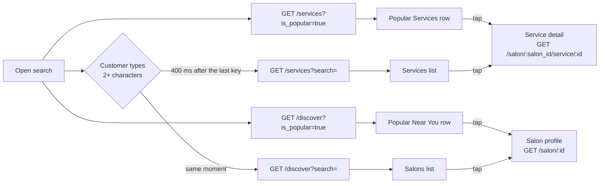

# Mobile Search: FE Guide

Date: 2026-11-03. For: the mobile app team.
Screen: the search over the map (`src/components/SearchModal.tsx`, Figma 3777:5634).

The search opens on three blocks (Recent searches, Popular Services, Popular
Near You) and, while the customer types, shows a Services list and a Salons
list. This guide is how to wire it to the server, step by step.

Your request is kept as `docs/search-popular-fe-contract.md`. The
field-by-field reference is `docs/SEARCH_POPULAR_API.md`. This guide follows
both.

**LIVE since 2026-11-03** (server switch `SEARCH_POPULAR_V1` is on).

---

## 0. Read this first

1. **Base URL:** `https://api.gostyle.uk/api/v1`. Every path below is relative
   to it.
2. **Auth is optional** on every call here. Send
   `Authorization: Bearer <app login token>` when the customer is signed in,
   nothing when not. A bad or expired token is `401` (as on `/discover`
   today): refresh it and retry, or retry without it.
3. **Two endpoints:** `GET /services` (services from every salon) and
   `GET /discover` (salons). Nothing is posted.
4. **Never send `tenant_id`, `branch_id` or `category_id` to `/services` here.**
   With any of them, `/services` is one salon's menu, an old answer with
   another shape (`{service_categories, service_groups}`).
5. **The position is three params, all or none:** `latitude`, `longitude`,
   `radius`. `radius` is in **kilometres**, the same number you already send
   to `/discover`. No position: leave all three out, and the lists cover the
   whole country.
6. **Paging:** `page` from 1, `pageSize` from 1 to 50. For more, call `next`
   as it is.
7. **Nothing found is never an error:** `200` with `"count": 0` and
   `"results": []`.
8. **The server decides the order.** Show the results in the order they come.
   Never sort them again in the app.

---

## 1. Endpoints at a glance

| Block | Call | § |
| ----- | ---- | -- |
| Recent searches | none (kept on the phone, as today) | |
| Popular Services | `GET /services?is_popular=true&pageSize=10` | 5.1 |
| Popular Near You | `GET /discover?is_popular=true&pageSize=10` | 5.2 |
| Typing: Services list | `GET /services?search=<text>&pageSize=20` | 6 |
| Typing: Salons list | `GET /discover?search=<text>&pageSize=20` | 6 |
| Tap a service | `GET /salon/{salon.id}/service/{id}` (already built) | 7 |
| Tap a salon | `GET /salon/{id}` (already built) | 7 |

Add `latitude`, `longitude` and `radius` to every call above when you have the
customer's position.

---

## 2. The flow



---

## 3. TypeScript types (copy these)

```ts
/** The page every list here comes in (the same as /discover today). */
type Page<T> = {
  count: number;          // every match, not only this page
  next: string | null;    // a full URL; null on the last page
  previous: string | null;
  results: T[];
};

type SalonCategory = "gents" | "ladies" | "unisex";

/** One result of GET /services: one service at one salon. */
type SearchService = {
  id: string;                    // the service's id (uuid)
  name: string;
  description: string | null;    // can also be ""
  price: number;                 // AED, one visit, this salon's own price (180, 180.5)
  duration_min: number;          // minutes; the same as duration_max today
  duration_max: number;
  category: { id: string; label: string }; // id is a uuid, or "other". Never null.
  salon: {
    id: string;                  // for GET /salon/{salon.id}/service/{id}
    name: string;
    category: SalonCategory | null; // null: use your default look
  };
};

/**
 * The salon card of GET /discover, the fields the search uses. The card has
 * more (rating, distance, open, gallery ...): docs/DISCOVERY_API.md.
 */
type SalonCard = {
  id: string;
  name: string;
  category: SalonCategory | null;
  logo_url: string | null;
  cover_url: string | null;
  rating: string | null;    // "4.5"; null when nobody reviewed it
  review_count: string;     // "0", "12"
  distance: string | null;  // "3.5 km"; null without a position
};

/** The customer's position. radius in KILOMETRES. */
type Position = { latitude: number; longitude: number; radius: number };

/** The error envelope (422 and the rest). */
type ApiError = {
  detail: string;
  code: string;
  errors: { field: string | null; code: string; message: string }[];
};
```

---

## 4. A small client (example)

Your own HTTP client is fine. This only shows the rules: empty values are left
out, the position goes as three params or none, the token is optional.

```ts
const BASE = "https://api.gostyle.uk/api/v1";

type Params = Record<string, string | number | boolean | undefined>;

function withPosition(params: Params, pos?: Position): Params {
  return pos
    ? { ...params, latitude: pos.latitude, longitude: pos.longitude, radius: pos.radius }
    : params;
}

function url(path: string, params: Params): string {
  const q = new URLSearchParams();
  for (const [key, value] of Object.entries(params)) {
    if (value !== undefined && value !== "") q.set(key, String(value));
  }
  return `${BASE}${path}?${q}`;
}

async function getJson<T>(fullUrl: string, token?: string, signal?: AbortSignal): Promise<T> {
  const res = await fetch(fullUrl, {
    headers: token ? { Authorization: `Bearer ${token}` } : {},
    signal,
  });
  if (!res.ok) {
    const body = (await res.json().catch(() => null)) as ApiError | null;
    throw Object.assign(new Error(`HTTP ${res.status}`), { status: res.status, body });
  }
  return res.json() as Promise<T>;
}
```

---

## 5. On open: the two rows

Call both at the same time. One failing must not hide the other.

```ts
async function loadPopular(pos?: Position, token?: string) {
  const [services, salons] = await Promise.allSettled([
    getJson<Page<SearchService>>(
      url("/services", withPosition({ is_popular: true, pageSize: 10 }, pos)), token),
    getJson<Page<SalonCard>>(
      url("/discover", withPosition({ is_popular: true, pageSize: 10 }, pos)), token),
  ]);
  return {
    popularServices: services.status === "fulfilled" ? services.value.results : [],
    popularSalons: salons.status === "fulfilled" ? salons.value.results : [],
  };
}
```

### 5.1 Popular Services

`GET /services?is_popular=true&pageSize=10` (+ position)

| Card | Field |
| ---- | ----- |
| Bold title, at most 2 lines | `name` |
| Price | `price` (AED) |
| 2 lines, then cut | `description`. Hide the line when it is `null` or `""` |

- **The order:** the most booked at that salon in the last 30 days first
  (cancelled bookings left out). Ties: the salon's rating, then the newest
  service.
- **At most 2 cards from one salon** in the row, so one busy salon does not
  fill it. Only when too few salons are near does one salon get more.
- **The same service at two salons is two cards**, each with its own salon
  and price. Use `salon.id` + `id` as the card's key, not `id` alone.
- **`results` empty: hide the row.**

### 5.2 Popular Near You

`GET /discover?is_popular=true&pageSize=10` (+ position)

| Card | Field |
| ---- | ----- |
| Square photo | `logo_url`, else `cover_url`, else your placeholder |
| Name | `name` |

- **The order:** a weighted rating (rating and how many rated it), highest
  first. A salon nobody reviewed comes after every rated one. Ties: more
  reviews first, then the nearest (when you send a position).
- **Today no salon has reviews yet**, so with a position this row is nearest
  first. It turns into a rating order by itself as reviews come in.
- Every other `/discover` param still works and narrows the list
  (`category`, `is_open_now`, `is_top_rated`, ...). `category=all` is the same
  as no category.
- **Send `pageSize`.** Without it, `/discover` gives 15 a page (its old
  default).
- **`results` empty: hide the row.**

---

## 6. While the customer types

- **Start at 2 characters** (count after trimming spaces), **400 ms after the
  last key.**
- **Two calls side by side:**
  - `GET /services?search=<text>&pageSize=20` (+ position): the Services
    list, each row with its salon (`salon.name`).
  - `GET /discover?search=<text>&pageSize=20` (+ position): the Salons list.
- **A new key cancels the old pair.** Abort the requests in flight, and drop
  any answer for a text that is no longer in the box.
- **Under 2 characters: no call.** Show the opening blocks again. Never send
  `search=` empty: an empty search is the same as no search, and `/services`
  then answers the newest services, not "nothing".
- **At most 100 characters.** Cut the text at 100 before you send it, or you
  get `422`.
- **"No results found"** only when **both** lists have `count: 0`. If one
  call fails, show the other's results. If both fail, show your error state.

What each list matches, case ignored, anywhere in the text:

| List | Matches | Not |
| ---- | ------- | --- |
| Services (`/services?search=`) | the service's `name`, or its `category.label` | its description, the salon's name |
| Salons (`/discover?search=`) | the salon's name, or its city | its services |

So "colour" finds "Root Colour" by its name and "Balayage" filed under "Hair
Colour". And "dubai" lists the salons in Dubai.

Without `is_popular`, the Services list is newest first. You may send
`is_popular=true` with `search` to rank the matches by bookings instead.

```ts
// React example: debounce, cancel, and drop stale answers.
function useSearchResults(text: string, pos?: Position, token?: string) {
  const [state, setState] = useState({
    services: [] as SearchService[],
    salons: [] as SalonCard[],
    searching: false,
    failed: false,
  });

  useEffect(() => {
    const term = text.trim().slice(0, 100);
    if (term.length < 2) {
      setState({ services: [], salons: [], searching: false, failed: false });
      return;
    }
    const abort = new AbortController();
    const timer = setTimeout(async () => {
      setState((s) => ({ ...s, searching: true }));
      const [services, salons] = await Promise.allSettled([
        getJson<Page<SearchService>>(
          url("/services", withPosition({ search: term, pageSize: 20 }, pos)), token, abort.signal),
        getJson<Page<SalonCard>>(
          url("/discover", withPosition({ search: term, pageSize: 20 }, pos)), token, abort.signal),
      ]);
      if (abort.signal.aborted) return; // a newer text took over
      setState({
        services: services.status === "fulfilled" ? services.value.results : [],
        salons: salons.status === "fulfilled" ? salons.value.results : [],
        searching: false,
        failed: services.status === "rejected" && salons.status === "rejected",
      });
    }, 400);
    return () => {
      clearTimeout(timer);
      abort.abort();
    };
  }, [text, pos?.latitude, pos?.longitude, pos?.radius, token]);

  return state;
}

// "No results found": !state.searching && !state.failed
//   && state.services.length === 0 && state.salons.length === 0
```

---

## 7. Taps

| Tap | Opens | Call | Notes |
| --- | ----- | ---- | ----- |
| A service (row or list) | Service detail | `GET /salon/{salon.id}/service/{id}` | Open it in `salon.category`'s look; `null` is your default look. Same price as the card. |
| A salon (row or list) | Salon profile | `GET /salon/{id}` | As from the map today. |

Both already exist and work without a token too.

---

## 8. Loading more (lists)

- `next` is a full URL with every param kept (`search`, the position,
  `pageSize`). Call it as it is, with the token if you have one. `null`
  means the last page.
- **Keep the same `pageSize` for every page of one list.** On
  `is_popular=true` the "2 per salon" rule is laid out page by page, so a
  new size starts a new layout.
- The order is fixed between pages: nothing repeats or goes missing while
  the customer scrolls.
- A page after the last is `404`. That only happens if you build page URLs
  yourself; with `next` it cannot.

---

## 9. Errors

| Status | When | What to do |
| ------ | ---- | ---------- |
| `200`, `count: 0` | Nothing matches, or no salon near | Hide the row, or "No results found" (§6) |
| `401` | A bad or expired token | Refresh the token and retry, or retry without it |
| `404` | A `page` after the last | Stop loading more |
| `422` | A param the server cannot read (below) | A bug in the call: log it, hide the row |
| `5xx`, network | Server or network down | Hide the row; on typing, your error state |

`422` comes in the usual envelope, naming the param:

```json
{
  "detail": "Please correct the highlighted fields.",
  "code": "validation_error",
  "errors": [
    { "field": "pageSize", "code": "invalid", "message": "Must be a whole number from 1 to 50, got '51'." }
  ]
}
```

| `errors[0].field` | Cause |
| ----------------- | ----- |
| `is_popular` | Not true/false (`true`, `false`, `1`, `0`, `yes`, `no` are fine) |
| `pageSize` | Not a whole number from 1 to 50 |
| `latitude` / `longitude` | One sent without the other |
| `radius` | Sent without a position, or 0 or less |
| `search` | Longer than 100 characters |
| `tenant_id` | Only if the server switch is ever turned off (§11) |

Popular Services never fails because booking data cannot be read: the server
then falls back to its tie order (the salon's rating, then the newest).

---

## 10. Field notes

1. **`category.id` is a uuid** (the same id as the chip on the salon's
   Services tab), or `"other"` for a service with no category. Not a slug.
2. **`radius` is in kilometres.** `radius=500` is 500 km, about the whole UAE.
3. **`/discover` without `pageSize` is 15 a page**, `/services` is 20. Send
   `pageSize` on both.
4. **`salon.category` can be `null`** (the salon has not said). The `/discover`
   card is `null` for the same salon.
5. **`duration_min` equals `duration_max` today** (a service has one
   duration). Show "30 min" when they are equal.
6. **`is_popular=true` on `/discover` wins over `sort`.** Do not send `sort`
   with it.
7. **`price` is a JSON number** in AED, and may have decimals (`180.5`). Format
   it as you do on the Services tab.

---

## 11. Rollout: `SEARCH_POPULAR_V1`

**On since 2026-11-03.** Nothing to wait for.

If the backend ever turns it off: `GET /services` without `tenant_id`
answers `422` (field `tenant_id`), and `/discover` ignores `is_popular` (its
normal order) and `pageSize` (15 a page). Treat a `422` on the Popular
Services row as "hide the row", and the app keeps working.

---

## 12. Try it

```sh
# Popular Services, near Downtown Dubai
curl -s 'https://api.gostyle.uk/api/v1/services?is_popular=true&pageSize=10&latitude=25.1972&longitude=55.2744&radius=50'

# Popular Near You
curl -s 'https://api.gostyle.uk/api/v1/discover?is_popular=true&pageSize=10&latitude=25.1972&longitude=55.2744&radius=50'

# Typing "cut"
curl -s 'https://api.gostyle.uk/api/v1/services?search=cut&pageSize=20'
curl -s 'https://api.gostyle.uk/api/v1/discover?search=cut&pageSize=20'

# Nothing near (a point at sea): 200 and count 0
curl -s 'https://api.gostyle.uk/api/v1/services?is_popular=true&latitude=0&longitude=0&radius=1'

# A 422
curl -s 'https://api.gostyle.uk/api/v1/services?pageSize=51'
```

---

## 13. QA checklist

- [ ] Open the search with location on: both rows show, up to 10 each.
- [ ] Open it with location off: both rows still show (the whole country).
- [ ] Popular Services: never more than 2 cards from one salon while other
      salons are near.
- [ ] The same service at two salons shows as two cards, each with its own
      price and salon, and no key warning in the list.
- [ ] Popular Near You: logo, else cover, else placeholder; and the name.
- [ ] A row with no results is hidden (try a point at sea, `radius=1`).
- [ ] Typing 1 character: no call. 2 characters: two calls, 400 ms after
      the last key.
- [ ] Typing fast: only the last text's results show.
- [ ] "colour" (or a category name) finds services by their category label.
- [ ] A salon's city finds its salons in the Salons list.
- [ ] "No results found" shows only when both lists are empty.
- [ ] Clearing the box (or 1 character left) shows the opening blocks again.
- [ ] A service tap opens its detail in the salon's look; a salon with no
      category opens in the default look.
- [ ] A salon tap opens its profile.
- [ ] Signed out works; signed in sends the token; an expired token is
      refreshed, not shown as an error.
- [ ] Scrolling a long list loads `next` with nothing doubled or missing.
