# Notifications, Settings and Privacy: Backend Audit and Plan

Status: written 2026-10-31 for review, then approved ("execute the plan best
way": the recommendation in each decision row is the decision). Phase 1 is
live and proven (2026-10-31, booking-api PR #27, customer-api PR #44).
Phase 2 is `feat/notification-center`.

Code read (live branches):

| Repo | Commit read | Notes |
| --- | --- | --- |
| gostyle-customer-api (Django) | imransid/main `f383927` | the app's API, this repo |
| gostyle-booking-api (NestJS, Prisma) | main `7eff1fc` | bookings, reminders, outbox |
| push-notification-service (NestJS) | imransid/main `e56e712` | FCM push transport |
| payment-service (NestJS, Prisma) | `build/phases-2-12`, no remote | not deployed |
| gostyle-platform (NestJS, Prisma) | origin/main `ca6bd044` | salon / business backend |
| review-service (NestJS, Prisma) | main `f2ca622` | not deployed |

Where the requirements come from: the written brief (screens: Notification
Center, Notification Preferences, Reminder timing, Privacy & Visibility). **The
Figma file itself was not attached**, so anything that depends on a detail only
the Figma shows (which tab a reminder sits in, default values, icons) is listed
as a decision, not guessed.

Words used here:

- **ALREADY IMPLEMENTED**: works today, read in code.
- **PARTIAL**: some of it is there.
- **NOT IMPLEMENTED**: nothing in any repo.
- **NEEDS IMPROVEMENT**: exists but is wrong or unsafe for this feature.
- **UNKNOWN**: cannot be proven from code (usually a server env value).

---

## 0. Summary

**What already exists (and must be reused):**

1. `GET/PATCH /api/v1/notifications/preferences` in customer-api, with all six
   event switches from the Figma plus a push master switch
   (`NotificationPreference`, one row per account).
2. Device tokens: `POST/DELETE /api/v1/me/device-tokens`, forwarded to
   push-notification-service, which fans out to every phone of a user over FCM
   with an `eventId` that stops duplicates.
3. booking-api already has a **reliable reminder system**: a claim "ladder"
   (24 h, 3 h, 15 min), a `notification_delivery` table with leases, retries,
   "superseded on move" and "skipped on cancel". It reads the customer's
   `appointment_reminder` and `push` switches over gRPC from customer-api.
   Delivery is behind `REMINDER_DELIVERY` (off by default; live value UNKNOWN).
4. booking-api already pushes "Booking confirmed / cancelled / moved" through an
   outbox listener.
5. Email works in customer-api (SendGrid API) and in booking-api (SMTP, reminders
   only). WhatsApp works in customer-api for OTP codes only.

**What is missing:**

1. No notification history anywhere: no inbox table, no categories, no
   read/unread, no unread count, no list API.
2. No email or SMS channel switch, no reminder timing choice (offsets are fixed
   in booking-api code).
3. No SMS provider in any repo.
4. No "show my name", "show my photo", or data export. "Moments" does not exist
   in any repo.
5. No source for "Order shipped" (no shop/orders anywhere) and no producer for
   promotions, new salons or loyalty messages.
6. customer-api has no background worker or queue at all.

**Recommended shape (Document 2):**

- **customer-api becomes the customer notification hub**: the inbox, the one
  preference gate, and the channel sender (push, email, later SMS), run by a
  new worker process from the same image (like the existing `grpc` service).
  No new library: Postgres `SKIP LOCKED` polling, the pattern booking-api,
  review-service, payment-service and platform already use.
- **booking-api stays the clock and the event source**: it keeps its outbox and
  its reminder ladder, adds one "chosen time" reminder per visit, and hands every
  customer-facing event to the hub over the gRPC server customer-api already runs.
- **push-notification-service stays a dumb push pipe** (small fixes only).

**Live problems found during the audit (Document 6.1):** booking pushes ignore
the customer's switches; a public payment webhook in booking-api falls back to
a known secret; signing a session out may not remove its push token on live;
"confirmed" is pushed for unpaid bookings; booking-api's default timezone is
`Asia/Dhaka`.

---

## Decisions needed before building

These change what gets built. My recommendation is first in each row.

| # | Question | Recommendation | Why |
| --- | --- | --- | --- |
| D1 | Who owns the customer inbox and the channel sending? | customer-api (hub). booking-api hands events over. | customer-api owns the customer, the preferences, the app's API and email. One gate, one inbox. |
| D2 | If "Booking confirmation" is OFF, does the item still appear in the Notification Center? | Yes. Switches control alerts (push, email, SMS). Booking and payment items always go to the inbox. Promotions go to the inbox only when their switch is on. | The center is the customer's history. A turned-off alert should not erase what happened. |
| D3 | Which tab holds bookings? Figma tabs: All, Orders, Updates, Payments, Promotions. | Orders: booking confirmed / changed / cancelled, check-in answers. Updates: appointment reminders, new styles at a salon, account and security notices. Payments: paid, refunded. Promotions: offers, new salons, loyalty. | There are no product orders, so Orders would be empty forever. Needs the designer's word. |
| D4 | Fixed reminders (24 h, 3 h, 15 min) vs the customer's choice | With the new switch on, an app booking gets **one** automatic reminder at the chosen time. The 3 fixed rungs stop for app bookings. The desk's manual "Remind" stays. | Up to 4 messages per visit is noise once the customer chooses a time. |
| D5 | Default reminder time | 1 day before | Closest to what customers get today (the 24 h rung). |
| D6 | Reminder time already passed | Booking made or moved after the reminder time: skip (the confirmation or "moved" message covers it). Customer changed the setting after the time: send once now if the visit is 15+ minutes away. | Stops a reminder seconds after booking. |
| D7 | Channel defaults and rules | Email ON (needs a verified email to switch on). SMS OFF (needs a verified phone and a provider). | Matches today: reminder emails already go to verified emails. |
| D8 | SMS: there is no provider in any repo. SMS always costs money (conflicts with the "free, never charges" rule). | Ship the SMS switch as stored-only, return `sms_available: false`, send nothing until a provider is chosen. Or: decide "SMS" in the Figma means WhatsApp (customer-api already has WhatsApp and a `whatsapp_booking_updates` switch that nothing uses). | Needs an owner decision and a budget. |
| D9 | List paging style | Cursor paging (`?cursor=`) for the list only | New items arrive at the top; page numbers then repeat or skip items. DRF has `CursorPagination` built in (no new library). |
| D10 | How long the inbox keeps items | 180 days, then deleted by the worker | push service keeps 90 days; the inbox is history, so a bit longer. |
| D11 | "Show my name to salons" OFF: what does the salon see? | First name + last initial ("Sara K.") on new bookings, and the full name is not written to the salon's customer record. | The desk still needs to call the customer at check-in. Legal/product owner must confirm. |
| D12 | "Show my photo in Moments": Moments does not exist | Store the setting (default OFF), document "no effect yet". Or hide the toggle until Moments exists. | Do not build enforcement for a feature that does not exist. |
| D13 | Data export: scope and delivery | JSON files in one zip: profile, preferences, privacy, sessions, favourites, notifications, uploads list, bookings. Ready in minutes, link in the app and by email, link valid 7 days, one request per 24 h. | Needs a way for a background job to read the customer's bookings from booking-api (see Document 2.9). |
| D14 | What counts as "Payment completed" | Only real gateway captures (`payment.captured`). Not the app's own "I paid" PATCH. | The PATCH is the customer telling us; a notice back to them adds nothing. Today the gateway is simulated, so this is dormant until a real gateway goes live. |
| D15 | "Order shipped" has no source | Keep `orders` as a category; build no order notices until a shop exists. | Do not invent an order system. |
| D16 | Promotions: who sends them, to whom | Not decided anywhere. Needed: author (HQ or salon), targeting, and for "new salons nearby" a customer location we do not store today. | Blocks the Promotions phase only. |

## Live checks (UNKNOWN from code)

Read-only commands for Rafa to run on the server. They print switch values,
and only "set / not set" for secrets.

```sh
# booking-api switches (values) and secrets (presence only)
docker service inspect gostyle-booking_api --format '{{range .Spec.TaskTemplate.ContainerSpec.Env}}{{println .}}{{end}}' \
  | grep -E '^(REMINDER_DELIVERY|CHECK_IN_PUSH_V1|BRANCH_TIMEZONE|PUSH_API_URL|SMTP_HOST)='
docker service inspect gostyle-booking_api --format '{{range .Spec.TaskTemplate.ContainerSpec.Env}}{{println .}}{{end}}' \
  | grep -oE '^(PAYMENT_WEBHOOK_SECRET|PUSH_API_KEY|INTERNAL_GRPC_KEY|SMTP_PASS)=' | sed 's/=$/ is set/'
docker service ls --filter name=gostyle-booking_api --format '{{.Name}} {{.Replicas}}'

# customer-api: is the session switch on?
docker service inspect gostyle-consumer_api --format '{{range .Spec.TaskTemplate.ContainerSpec.Env}}{{println .}}{{end}}' \
  | grep -E '^(DEVICE_SESSIONS_V1|TWO_FACTOR_V1)='

# push service: does the live build have the sign-out route?
# 404 = route missing; 401 or 403 = route exists (it wants the API key)
docker exec $(docker ps -qf name=push-app | head -1) sh -c \
  'wget -qS -O- --post-data="{}" --header="Content-Type: application/json" http://127.0.0.1:3351/devices/unregister-session 2>&1 | head -1'

# push cleanup cron
crontab -l | grep -i cleanup
```

---

# Document 1: Existing Backend Audit

## 1.1 How the services talk today

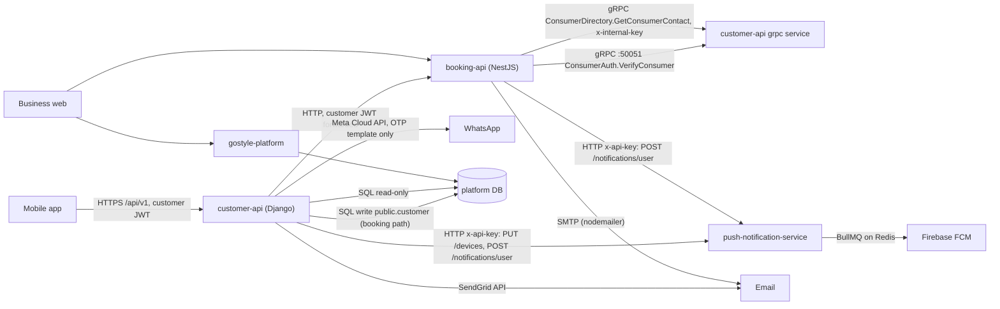

Facts behind the arrows:

- customer-api runs three Swarm services from one image: `api` (gunicorn, 2
  replicas), `grpc` (1 replica, `manage.py grpcserver`, port 50051, no TLS,
  overlay network only) and `redis` (cache and rate limits only)
  (`docker-compose.yml:4-175`). **No worker, no queue, no cron.** Redis is used
  by `CACHES` (`config/settings/base.py:441-446`) and the OTP limits
  (`apps/accounts/ratelimit.py`).
- booking-api is a gRPC **client** only (no gRPC server, no WebSocket). It polls
  its own Postgres with `@nestjs/schedule` intervals. `bullmq` and `ioredis` are
  in its `package.json` but **not used** in `src/`.
- push-notification-service is the only user of BullMQ in production.
- gostyle-platform's outbox is **in-process only** (EventEmitter2). No other
  service can subscribe to it today except by polling `outbox_message`.
- payment-service and review-service are **not deployed**.

## 1.2 Feature inventory

### A. Notification Center

| Requirement | Status | Where / evidence | What is missing |
| --- | --- | --- | --- |
| List my notifications | NOT IMPLEMENTED | No inbox table in any repo. push service `notifications` table is a per-device send log (`push-notification-service/src/notification/infrastructure/postgres-notification.repository.ts:20-42`): one row per (user, event, device), no row at all when the user has no phone registered. | Inbox table and API in customer-api |
| Filter by category | NOT IMPLEMENTED | No category column anywhere | `category` on the inbox row |
| Paging and sorting | NOT IMPLEMENTED for this; the house style exists | `config/pagination.py` `ClientPageNumberPagination` (`page`, `page_size`, max 50) | Cursor paging for this list (D9) |
| Read / unread, mark one, mark all | NOT IMPLEMENTED | No `read_at` anywhere | `read_at` + 2 endpoints |
| Unread count | NOT IMPLEMENTED | | Count endpoint + partial index |
| Group by Today / Yesterday / This week | NOT IMPLEMENTED | | Done by the app from ISO times (the phone knows its zone). Server sorts newest first. |
| Detail + deep link data | PARTIAL | Push `data` today: booking events `{type, bookingId}` (`gostyle-booking-api/src/infrastructure/messaging/push-listener.ts:73-78`), reminders `{type, bookingId, code, startAt}` (`dispatch-reminders.handler.ts:242-247`), sign-in `{type, sessionId}` (`apps/accounts/notifications.py:316-351`). No `target` field, no shared contract. | One `target_type` + `target_id` contract |
| Real-time | PARTIAL | FCM push reaches phones today. No WebSocket or SSE for customers anywhere. platform has Socket.IO, but for staff support chat only (`apps/gostyle-api/src/platform-support-chat.gateway.ts`, staff JWT). | Push carries `notificationId`; app refreshes the count. No socket needed (Document 2.8). |
| Empty state (no bookings, no notifications) | NOT IMPLEMENTED | | List answers `200` with `results: []`, count `0`. Nothing is seeded. |

### B. Notification Preferences

| Requirement | Status | Where / evidence | What is missing |
| --- | --- | --- | --- |
| Booking confirmation, Appointment reminder, Booking changes, Special offers, New salons nearby, Loyalty & rewards | ALREADY IMPLEMENTED (stored) | `apps/accounts/models.py:423-469` `NotificationPreference` (one-to-one, created lazily with defaults). Fields `booking_confirmation`, `appointment_reminder`, `booking_changes`, `special_offers`, `new_salons`, `loyalty`. Route `apps/accounts/urls.py:34`, view `apps/accounts/notification_views.py:117-133`, serializer `apps/accounts/notification_serializers.py`. Tests `apps/accounts/tests/test_notification_preferences.py`. Added in `3095e26` (2026-10-02). | Nothing for storage |
| ... respected before sending | NEEDS IMPROVEMENT | Only `appointment_reminder` and `push` are honoured, and only by booking-api reminders (`dispatch-reminders.handler.ts:216-227, 267-278`) and customer-api's sign-in push (`notifications.py:316-351`). **booking-api's "confirmed / cancelled / moved" pushes check no switch at all** (`push-listener.ts:61-85`). `booking_confirmation` and `booking_changes` are not even in the gRPC contract (`proto/consumer_directory.proto`). | Gate every send |
| Push channel | ALREADY IMPLEMENTED | `push` master switch (`models.py:449`) | |
| Email channel | NOT IMPLEMENTED | The serializer refuses `email` as an unknown key; the test uses it as the example (`test_notification_preferences.py`, `test_unknown_field_is_400_and_saves_nothing`). | `email` switch |
| SMS channel | NOT IMPLEMENTED | No SMS code in any repo. customer-api: "Phone OTP goes over WhatsApp only; there is no SMS fallback" (`notifications.py:15-19`). platform SMS falls back to console. | `sms` switch, provider (D8) |
| Update one / many safely | ALREADY IMPLEMENTED | PATCH is partial, strict booleans only, unknown keys refused before anything is saved, and only the sent columns are written (`notification_serializers.py:37-63`). | |
| Persist across sessions and devices | ALREADY IMPLEMENTED | Stored server-side per account | |
| Channel / event compatibility check | NOT IMPLEMENTED | | A server-side matrix (Document 2.6) |
| Related: WhatsApp booking updates switch | PARTIAL | `whatsapp_booking_updates` (`models.py:450-454`), read/written via `/auth/me` only, needs a verified phone (`apps/accounts/serializers.py:140-151, 216-235`). The model says "Nothing sends them yet." | Overlaps the Figma "SMS" (D8) |

Convention note: this endpoint answers validation errors with **400**, while
the rest of the API answers **422** (`apps/accounts/exceptions.py:13, 106-109`).
It is documented that way for the app (`docs/ACCOUNT_ME_API.md:35-36, 224-236`),
so new fields on this endpoint must keep 400.

### C. Appointment reminder timing

| Requirement | Status | Where / evidence | What is missing |
| --- | --- | --- | --- |
| Schedule from booking start | ALREADY IMPLEMENTED | `gostyle-booking-api/src/domain/booking/reminders.ts:38-60` `LADDER` (24 h push+email, 3 h push+email, 15 min push). Claim every 60 s in one statement with `FOR UPDATE SKIP LOCKED LIMIT 200`, stamping `reminded_24h_at` / `reminded_3h_at` / `nudged_15m_at` and writing an outbox event in the same transaction (`src/infrastructure/persistence/reminder.repository.ts:71-144`, `prisma/schema.prisma:197-199`). | |
| User's chosen time (30 min, 1 h, 2 h, 1 day) | NOT IMPLEMENTED | Offsets are constants. No field in customer-api, no field in the gRPC contract. The column-per-rung design does not stretch to a per-customer offset. | `reminder_lead_minutes` + a "chosen" rung (Document 2.7) |
| Send through enabled channels | PARTIAL | Push skipped if `appointment_reminder` or `push` is off; email skipped if `appointment_reminder` is off, no email, or email not verified (`dispatch-reminders.handler.ts:206-291`). No email switch exists to check. | Email / SMS switches |
| Reschedule | ALREADY IMPLEMENTED | Both reschedule paths clear the stamps (`reschedule.repository.ts:245-247, 444-446`); an old delivery whose `scheduled_for` no longer equals `start_at` becomes `superseded` (`src/domain/booking/reminder-delivery.ts:137`); push eventId includes the start time (`reminder:<bookingId>:<rung>:<scheduledForMs>`, `reminder-delivery.ts:95-101`). | Same for the new rung |
| Cancel | ALREADY IMPLEMENTED | Checked at send time: not live means `skipped` with reason `booking_<status>` (`reminder-delivery.ts:133-135`) | |
| No duplicates | ALREADY IMPLEMENTED | Stamp column claim + `UNIQUE(source_event_id, channel)` on `notification_delivery` (`schema.prisma:720`) + push service eventId | |
| Timezones | NEEDS IMPROVEMENT | Times are `timestamptz` (UTC), so "N minutes before" is exact. But the **text** ("today at 3:00 PM") uses one process-wide `BRANCH_TIMEZONE`, default **`Asia/Dhaka`** (`docker-compose.yml:57`, `src/infrastructure/persistence/hold.repository.ts:13, 30-53`). customer-api uses `branch.timezone` with an `Asia/Dubai` fallback (`apps/salons/timezones.py`). Live value UNKNOWN. | Use the salon's zone for the text |
| Booked or changed after the reminder time | ALREADY IMPLEMENTED (for fixed rungs) | A missed rung is stamped "skip", nothing sent (`reminders.ts:187-212`). | Rule for the chosen rung (D6) |
| Background processing, retries | ALREADY IMPLEMENTED | `notification_delivery` (`schema.prisma:691-723`): lease 5 min, max 6 attempts, backoff 1/5/15/30/60 min, never past `expires_at`, write-back fenced on attempt number (`notification-delivery.repository.ts:114-199`, `reminder-delivery.ts:60-77, 180-244`). Dispatcher every 10 s (`reminder-dispatch.service.ts:45`). Health on `/health` (`reminder-health.ts:28-50`). About 116 unit tests on this code. | |
| Switch | UNKNOWN | `REMINDER_DELIVERY` (off by default, `reminder-delivery-listener.ts:18-19`). With it off, the ladder still stamps and writes events, so rungs claimed while off are never sent later. | Check live value |
| Quiet hours | PARTIAL | 09:00-21:00 applies to the desk's manual remind only (`src/domain/booking/quiet-hours.ts:15-18`), not to the automatic ladder. | Not needed for a time the customer chose |

### D. Privacy & Visibility

| Requirement | Status | Where / evidence | What is missing |
| --- | --- | --- | --- |
| Show my name to salons | NOT IMPLEMENTED | Salons see the name from two places: (1) customer-api writes `first_name`, `last_name`, phone and email into the salon's `public.customer` row on the booking path (`apps/salons/customer_sync.py:25-43`, called from `apps/salons/views.py:2339-2350`); staff read it unmasked via platform `GET /v1/customers/:id`. (2) booking-api's check-in desk reads `full_name` over gRPC (`gostyle-booking-api/src/application/commands/check-in-desk.handler.ts:203, 242`). platform `Customer` has consent flags (`marketingOffersEnabled`, `whatsappReminderEnabled`, `personalizationEnabled`) but no visibility flag. (The desk calendar's names come from a fixture adapter, `src/infrastructure/fixtures/fixture-customer-context.ts`, bound in `persistence.module.ts:128`.) | Setting + 2 enforcement points (D11) |
| Show my photo in Moments | NOT IMPLEMENTED, and **no Moments feature exists** | Searched all six repos (moment, ugc, lookbook, before/after, customer photo, post). Stories and gallery are salon-uploaded only (`StorefrontMedia` kinds COVER, LOGO, GALLERY, STORY, CERTIFICATION). Reviews have no photo. The customer's own `image` URL is on the account (`models.py:74`) and is not sent to platform. | Setting only (D12) |
| Download my data | NOT IMPLEMENTED | No export in customer-api or platform (platform's `UserExport` is the staff roster). Account deletion exists: `POST /auth/me/delete`, `/cancel`, `purge_due_accounts` (`apps/accounts/management/commands/purge_due_accounts.py`), **not scheduled** on the server. | Export job + 2 endpoints |
| Location access | NOT A BACKEND SETTING | Discovery takes `latitude`/`longitude` per request and stores nothing (`apps/salons/params.py:119-186`). `location` on the account is a free text field (`models.py:78`). Session location comes from the IP (DB-IP Lite), a security feature, not this switch. | Nothing. It is the phone's OS permission. |

### E. Channels and infrastructure

| Item | Status | Evidence |
| --- | --- | --- |
| Push transport | ALREADY IMPLEMENTED, NEEDS IMPROVEMENT | push service: `PUT /devices`, `POST /devices/unregister`, `POST /notifications/user` (fan-out per device, BullMQ, 3 attempts with backoff, dead tokens marked `invalid`), dedupe by unique `(user_id, event_id, device_token)`. Gaps: no `apns`/`android` block (no badge, no priority), no multicast or topics, BullMQ concurrency 1, jobs never removed from Redis, single shared non-timing-safe API key (`presentation/api-key.guard.ts:13-15`), no rate limit, DDL at boot. |
| Device registry, multi-device | ALREADY IMPLEMENTED | `devices` table, token unique, moves to the new user on login. A legacy `accounts.Device` table in customer-api (`models.py:304-330`) is **not written by anything**, so `/auth/me` `push_token` (`serializers.py:264-270`) is always null or stale. |
| Session-aware tokens | NEEDS IMPROVEMENT | customer-api sends `sessionId` and calls `POST /devices/unregister-session` (`apps/accounts/push_api.py:23-50`, `sessions.py:631-660`). That route lives on push branch `feat/device-session-id` (`858e692`), **not merged** into imransid/main. On a 404 customer-api treats the session as done (`sessions.py:637`), so the token stays. Live build UNKNOWN. |
| Email | ALREADY IMPLEMENTED (two stacks) | customer-api: SendGrid API backend (`apps/accounts/sendgrid_backend.py`, `config/settings/base.py:579-588`), branded layout `emails.py:118` `render_email_shell`, notices `emails.py:303` `build_notice_email`. booking-api: SMTP via nodemailer, reminders only (`src/infrastructure/messaging/smtp-email.client.ts`), its own HTML layout (`reminder-email.layout.ts`). platform: SendGrid, staff emails only. |
| SMS | NOT IMPLEMENTED | Nowhere. |
| WhatsApp | PARTIAL | customer-api OTP template only (`notifications.py:81-135`). review-service invites (Meta API) but not deployed. platform stub logs only. |
| Queue | PARTIAL | BullMQ only inside push service. booking-api has it installed, unused. customer-api has none. |
| Scheduled jobs | booking-api: 12 interval/cron jobs, all multi-replica safe by `SKIP LOCKED`, row locks or advisory locks (except `risk-flag-expiry`, no lock). customer-api: none. Push cleanup is a root crontab SQL script (UNKNOWN on server). |
| Event bus | booking-api outbox `EventOutbox` (`schema.prisma:632-653`), relay every 1 s, 50 per batch, `SKIP LOCKED`, **no backoff**, gives up after 10 attempts; listener chain runs **inside** the relay transaction (`outbox-relay.service.ts:89-147`). Events relevant here: `booking.confirmed`, `booking.cancelled`, `booking.rescheduled`, `booking.<status>`, `reminder.*`, `check_in_request.*`, `payment.captured / capture_failed / refunded / refund_failed`, `series.*`, `waitlist.offered`. |
| gRPC | customer-api serves `ConsumerAuth.VerifyConsumer` and `ConsumerDirectory.GetConsumerContact` on :50051 (`apps/grpc_gen/servicer.py:111-170`). The directory call fails closed without `x-internal-key` (`servicer.py:96-108`). booking-api calls it with a 2 s timeout and retry on UNAVAILABLE (`grpc-customer-contact.ts:96-144`); it ignores `language`. |
| Auth | customer-api: SimpleJWT with session check (`SessionJWTAuthentication`), `IsAuthenticated` default, `IsVerified` for sensitive routes (`apps/accounts/permissions.py`). booking-api: `BookingAuthGuard` closed by default, customers via ConsumerAuth, `@DeskOnly()`, `refuseOutOfScope`. |
| Logging / monitoring | customer-api: JSON logs to Loki through Alloy (`docs/OBSERVABILITY.md`, `config/settings/base.py:534`). booking-api: Nest Logger, `/health` with reminder queue age. push service: two log lines, no metrics, no health. |
| Tests | customer-api: Django `manage.py test`, about 2,090 test functions, CI runs it (`.github/workflows/ci-cd.yml:90-91`); main already has 48 salons test errors. booking-api: vitest, about 182 spec files. push service: 7 unit specs. |
| Deploy | customer-api built on the server as `:local`, migrations on container start; switches saved on the service with `--env-add`. booking-api via laptop `deploy.sh`, migrations as a separate job. push service via docker compose on the server. |

### F. Payments, orders, promotions (sources for the other tabs)

| Item | Status | Evidence |
| --- | --- | --- |
| Payment completed | PARTIAL (event exists, nothing sent) | booking-api writes `payment.captured` from `POST /webhooks/payments` (`src/interface/http/webhooks.controller.ts:33-129`, `payment-webhook.repository.ts:195-199`). The gateway is `SimulatedGateway` (`persistence.module.ts:115-117`): no real money. The app's own "record the payment" PATCH (`apps/salons/views.py:2848-2880` to `mobile-payment.repository.ts:40-140`) and desk capture write **no** event. No listener sends `payment.*` to the customer. |
| Payment refunded | PARTIAL | `payment.refunded` from the webhook. A cancel's refund is an internal wallet credit carried inside `booking.cancelled` as `refundFils` / `keptFils` (`lifecycle.repository.ts:396-412, 509-532`). |
| payment-service | NOT LIVE | Full Kashier service with outbox and signed webhooks (`payment.succeeded`, `payment.refunded`, `payment.refund_failed`), never pushed, no caller, no AED support (`kashier.provider.ts:71`). Its webhook format does not match booking-api's receiver. |
| Order shipped | NOT IMPLEMENTED, no source | No orders, cart or shipping anywhere. Retail is sold at the POS only. |
| Promotions / new styles / new salons / loyalty | NOT IMPLEMENTED, sources weak | platform has `StorefrontOffer`, POS `Promo`, catalog events `catalog.service.published.v1`, `catalog.service.media_added.v1` (no listeners), **no** event on storefront publish, offer create or loyalty points. Loyalty accounts are per salon and keyed by the platform customer id. customer-api `points` / `tier_level` are stubs (`serializers.py:256-262`). |

## 1.3 Things that already work well and must be kept

- booking-api's reminder engine (claim ladder, delivery rows, leases, fences,
  superseded and cancel checks, `/health` metrics). It is the best-built part of
  the notification path. Extend it, do not copy it.
- push service eventId dedupe and dead-token clean-up.
- customer-api's fail-closed internal gRPC key, strict boolean preferences,
  lazy defaults, `db_default` columns that keep a rollback safe.
- The house pattern for background work: Postgres row + `SKIP LOCKED` + lease
  + polling. Every NestJS service uses it. It needs no new dependency.

---

# Document 2: Recommended Architecture

## 2.1 Rules this design follows

1. One owner per fact. Bookings and their times: booking-api. Customers,
   preferences, privacy, inbox: customer-api. Push devices: push service.
2. One preference gate for customer messages, in customer-api.
3. No new library, no new service, no new datastore. A new **process** from the
   existing customer-api image, like `grpc`.
4. booking-api changes are additive and behind switches that are OFF
   (business-web golden rules). Mobile and business-web changes in separate PRs.
5. Every hop is retryable and idempotent: a retry never sends twice.
6. No network call inside a database transaction that holds business rows.

## 2.2 Who owns what

| Concern | Owner | Change |
| --- | --- | --- |
| Booking lifecycle events | booking-api outbox | Reuse. Add an event where money is recorded without one (phase 6). |
| When a reminder is due | booking-api ladder | Add a "chosen" rung reading the customer's lead time. |
| Reliable hand-off of booking events | booking-api `notification_delivery` | Add channel `hub`. |
| Preferences, channel rules | customer-api `NotificationPreference` | Add `email`, `sms`, `reminder_lead_minutes`. |
| Inbox (Notification Center) | customer-api, new app `apps/notifications` | New. |
| Push / email / SMS sending for customers | customer-api worker | New process. Push via push service, email via SendGrid (already here), SMS later. |
| Push transport | push-notification-service | Small fixes only. |
| Privacy settings | customer-api `ConsumerAccount` | 2 new columns. |
| Data export | customer-api worker + S3 (already configured) | New. |
| Promotions content | Not decided (D16) | Later. |

## 2.3 Target picture

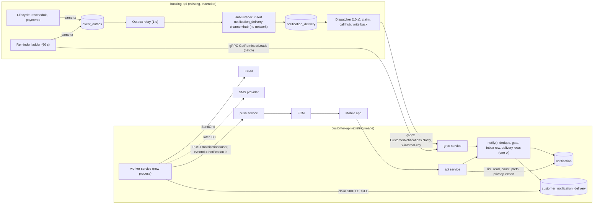

## 2.4 New and changed components

**customer-api**

- `apps/notifications/` (new Django app):
  - `models.py`: `Notification`, `NotificationDelivery`, `DataExportRequest`.
  - `registry.py`: one table of notification types: category, which preference
    switch gates it, which channels it may use, whether it always goes to the
    inbox, deep-link target. Adding a type is one line, no migration.
  - `service.py`: `notify(account, type, dedupe_key, title, body, data, target,
    occurred_at, source)`. One transaction: insert inbox row
    (`ON CONFLICT (account, dedupe_key) DO NOTHING`), run the gate, insert one
    delivery row per allowed channel. Returns the row and whether it was a
    duplicate. Used in-process by customer-api's own events (sign-in alert) and
    by the gRPC servicer.
  - `worker.py` + `management/commands/notification_worker.py`: a loop that
    claims due delivery rows with `select_for_update(skip_locked=True)`, sends,
    and writes back. Same loop runs housekeeping on a timer: inbox retention
    and, later, export clean-up. Not `purge_due_accounts`: running it starts
    real account deletions, which is its own decision (R11).
  - `senders.py`: push (reuses `apps/accounts/push_api.send_to_user`), email
    (reuses `EmailMultiAlternatives` + `emails.render_email_shell`), SMS stub.
  - `views.py`, `serializers.py`, `urls.py`: the inbox API.
  - `servicer.py` + `proto/customer_notifications.proto`: gRPC `Notify` and
    `GetReminderLeads`, registered in the existing `grpcserver` command.
- `apps/accounts`: new preference fields; privacy columns; privacy and export
  views; `send_new_sign_in_push` moves onto `notify()`.
- `docker-compose.yml`: a `worker` service (same image, command
  `python manage.py notification_worker`, replicas 1, can go to 2).

**booking-api**

- `notification_delivery` gets channel `hub`; a `HubListener` link in the chain
  (outside the current push links) turns customer-facing events into `hub` rows.
  With `MOBILE_NOTIFY_HUB` on, `PushListener`, `CheckInPushListener` and the
  reminder push/email rows step aside for app bookings. Off, nothing changes.
- Ladder: a fourth rung `chosen` (switch `MOBILE_REMINDER_CHOICE`).
- gRPC client: `Notify` and `GetReminderLeads`.

**push-notification-service**

- Merge `feat/device-session-id`. Add `removeOnComplete/removeOnFail`,
  timing-safe key compare, optional `badge` (APNs) and `priority`.

## 2.5 The hub, step by step

1. **Intake** (`notify()`): validate the type against the registry; find the
   account (`is_active`, not purged); a missing account is a normal "not found"
   answer, not an error.
2. **Dedupe**: `UNIQUE(account_id, dedupe_key)`. The producer's key is used as
   is (booking-api: its outbox event id plus the type). A replay returns the
   first row and creates nothing.
3. **Inbox rule**: transactional types always get an inbox row; promotional
   types only when their switch is on (D2).
4. **Gate** (2.6) decides the channels; one `customer_notification_delivery` row per
   allowed channel, `status=pending`, `next_attempt_at=now`, `expires_at` from
   the type (a reminder expires at the visit start).
5. **Worker** claims rows (lease 2 min by pushing `next_attempt_at`), sends, and
   writes back `sent / failed / skipped`, fenced on the attempt number.
6. **Push** uses `eventId = "ntf:<notification id>"`, so the push service drops
   a repeat even if the worker crashed after FCM accepted it.
7. **Email** re-reads the address at send time and needs it verified (the rule
   booking-api already uses, `dispatch-reminders.handler.ts:252-278`).

## 2.6 Preference gate

| Type (examples) | Category (D3) | Event switch | Push | Email | SMS | Inbox |
| --- | --- | --- | --- | --- | --- | --- |
| `booking.confirmed` | orders | `booking_confirmation` | yes | yes | yes | always |
| `booking.rescheduled`, `booking.cancelled`, `booking.cancelled_by_salon` | orders | `booking_changes` | yes | yes | yes | always |
| `check_in.approved / rejected / expired` | orders | none: it answers the customer's own tap at the desk | yes | no | no | always |
| `booking.reminder` | updates | `appointment_reminder` | yes | yes | yes | always |
| `payment.completed`, `payment.refunded` | payments | none (always alert) | yes | yes | no | always |
| `account.new_sign_in` and other security notices | updates | `sign_in_alerts` (existing, account column) | yes | yes (already sent) | no | always |
| `promo.offer` | promotions | `special_offers` | yes | yes | **never** | only if switch on |
| `promo.new_salon_nearby` | promotions | `new_salons` | yes | no | never | only if switch on |
| `loyalty.*` | promotions | `loyalty` | yes | yes | never | only if switch on |
| `salon.new_styles` | updates (D3) | `special_offers` or its own switch (D3) | yes | no | never | only if switch on |

A channel is used only when: the type allows it, the event switch is on, the
channel switch is on (`push`, `email`, `sms`), and the channel can work
(push service configured; verified email; verified phone and an SMS provider).
Payment and security notices ignore the event switches on purpose (money and
account safety), but still honour the channel switches. This matrix lives in
`registry.py` only; booking-api never reads preferences for hub sends.

## 2.7 Reminder timing

**Where the clock lives:** booking-api. It has the booking times, clears stamps
on every move, and already checks "still live, same start" at send time.
Building a second scheduler in customer-api would copy all of that.

**How booking-api learns the customer's choice:** it asks, every tick, in one
batch. No copy of the preference is kept in booking-api, so a change in the app
counts from the next minute.

1. Ladder tick (every 60 s, unchanged timer). New step for the `chosen` rung:
   select live app bookings (`confirmed`, `pending_payment`) with
   `start_at` between now and now + 1 day + 2 min and `reminded_chosen_at IS
   NULL` (partial index).
2. One gRPC call `GetReminderLeads(consumer_ids)` returns, per customer,
   `{enabled: appointment_reminder, lead_minutes}`. Memoised for the tick.
   If customer-api cannot be reached, the step is skipped this tick (the hub
   that would send it is the same service, so nothing is lost by waiting).
3. For each booking: `due = start_at - lead`. Not due yet: leave it. Due: claim
   it in one statement (stamp `reminded_chosen_at`, `reminder_lead_min`, write
   outbox `reminder.chosen` in the same transaction), `SKIP LOCKED`.
4. Already past due at first sight (D6): if the booking was created or last
   moved after `due`, stamp it with "skip" and send nothing. Otherwise send now
   when the visit is 15 or more minutes away; else skip.
5. Reschedule: the existing clear-stamps code also clears `reminded_chosen_at`.
   The old delivery is superseded by the existing `scheduled_for != start_at`
   check. Cancel: the existing send-time live check.
6. Customer turns reminders off after the claim: the hub's gate sees
   `appointment_reminder = false` at send time and skips.
7. With `MOBILE_REMINDER_CHOICE` on, the three fixed rungs are not claimed for
   app bookings (D4); desk-only bookings keep the old ladder.

Timezones: the due time is pure UTC arithmetic (`start_at - lead`), so no zone is
involved in scheduling. Zones matter only for the words. The hub renders the
time with the salon's own zone (`branch.timezone` via `apps/salons/timezones.py`,
which customer-api already reads), not with booking-api's single
`BRANCH_TIMEZONE`. "1 day before" means 24 hours (no daylight saving in the UAE;
the rule stays correct elsewhere because it is a duration).

## 2.8 Real-time

No WebSocket. customer-api is a WSGI app; sockets would need ASGI and a new
library, and the only socket stack in the company (platform Socket.IO) is
staff-authenticated. Instead:

- Every push carries `data.notificationId`, `data.category`, `data.targetType`,
  `data.targetId`. On receipt the app refreshes `GET /notifications/unread-count`
  and, if the center is open, the first page.
- On app foreground the app refreshes the count (one cheap indexed query).
- Optional (push service phase): APNs `badge` = unread count, which the worker
  computes at send time.

## 2.9 Data export

- `POST /me/data-export` creates a `DataExportRequest` (one active per account,
  one per 24 h). The worker builds a zip of JSON files, uploads it to a
  **private** S3 prefix (today's upload storage builds public-style URLs,
  `config/settings/base.py:74-94`, so exports must use a separate private
  location and a pre-signed link), stores the key, and creates an inbox item +
  email "Your data is ready". The link expires after 7 days and the file is
  deleted.
- Bookings: the worker needs to read the customer's bookings from booking-api
  without a customer request in hand. Options: (a) a new booking-api internal
  route protected by a service key, read-only, scoped to one customer id; (b)
  customer-api mints a short-lived customer token for the job. Recommend (a);
  it is a business-web-safe additive route. Until it exists, the export says
  "bookings not included" rather than silently leaving them out.
- Purge: `purge()` also deletes export files and inbox rows (the account row is
  kept anonymised today, so `CASCADE` alone does not run).

## 2.10 Privacy enforcement

- `show_name_to_salons = false` (D11): `customer_sync.resolve_customer` writes
  the short name instead of the full one on new bookings, and
  `ConsumerDirectory.GetConsumerContact` returns the short name. Existing
  platform rows are not rewritten unless the owner decides so (they belong to
  the salon's CRM). Group party names follow the same rule.
- `show_photo_in_moments` (D12): stored, returned, no effect until Moments
  exists. The day Moments is built, its read path must filter on it.

## 2.11 Idempotency and duplicate prevention

| Hop | Key | Enforced by |
| --- | --- | --- |
| Business change to event | outbox row written in the same transaction | Postgres transaction (existing) |
| Relay to listener | outbox `processed_at`, at-least-once | Listener must be idempotent |
| Listener to hub row | `UNIQUE(source_event_id, channel)` + `skipDuplicates` | existing constraint |
| booking-api to customer-api | `dedupe_key = "<type>:<source_event_id>"` (reminder: `reminder:<bookingId>:<startAtMs>`) | `UNIQUE(account_id, dedupe_key)` |
| Inbox row to channel | `UNIQUE(notification_id, channel)` | new constraint |
| Worker to push service | `eventId = "ntf:<notification id>"` | push service unique index |
| Chosen reminder per visit start | `reminded_chosen_at` stamp, cleared on move | claim `UPDATE ... WHERE stamp IS NULL` |
| Export | partial unique: one pending/running per account | new constraint |
| Mark all read | `before` timestamp in the request | update only rows created at or before it |

## 2.12 Retries and failures

| Where | Policy |
| --- | --- |
| booking-api `hub` rows | existing engine: 6 attempts, 1/5/15/30/60 min, never past `expires_at`; `NOT_FOUND` account is `skipped`, `UNAVAILABLE` is retry |
| customer-api push | 5 attempts, 30 s / 2 / 10 / 30 / 60 min; 4xx from push service = failed; 202 with `devices: 0` = skipped (`no_devices`); timeout / 5xx = retry |
| customer-api email | same backoff; SendGrid 4xx = failed; no verified email = skipped |
| expired rows | `expires_at` passed = skipped (`expired`), never sent late (a reminder after the visit is noise) |
| stuck rows | a row whose lease passed comes due again by itself |
| visibility | counts of pending, oldest due age, failed in last hour, logged every minute as JSON (Loki) and on a `/health/notifications` staff-only view |

Fix while there: booking-api's outbox relay retries every second with no
backoff, and `PushListener` makes network calls inside the relay transaction.
Moving sends to `hub` rows removes the network calls from that transaction.

## 2.13 Multi-device and sessions

The push service already fans out to every active device of a user. Correct
sign-out removal depends on merging `feat/device-session-id`; until then a
signed-out phone can keep receiving pushes (Document 6.1, R3). Push text must
be safe on a lock screen: booking code and salon name yes, amounts and email
no.

## 2.14 Scale and performance

- Inbox list: index `(account_id, created_at DESC, id DESC)`; cursor paging
  reads one index range. Unread count: partial index `WHERE read_at IS NULL`.
- Worker: one replica handles hundreds of sends a second (each send is one
  HTTP call with a 3 s timeout). Two replicas are safe (`SKIP LOCKED`).
- Promotions fan-out (later): a campaign creates inbox and delivery rows in
  batches of 500 accounts per transaction; push service concurrency must be
  raised from 1 before any campaign goes out.
- `GetReminderLeads`: one call per minute with the customers who have a visit
  in the next day, by primary key. Cheap.

## 2.15 Flowcharts

### 1. Booking confirmation

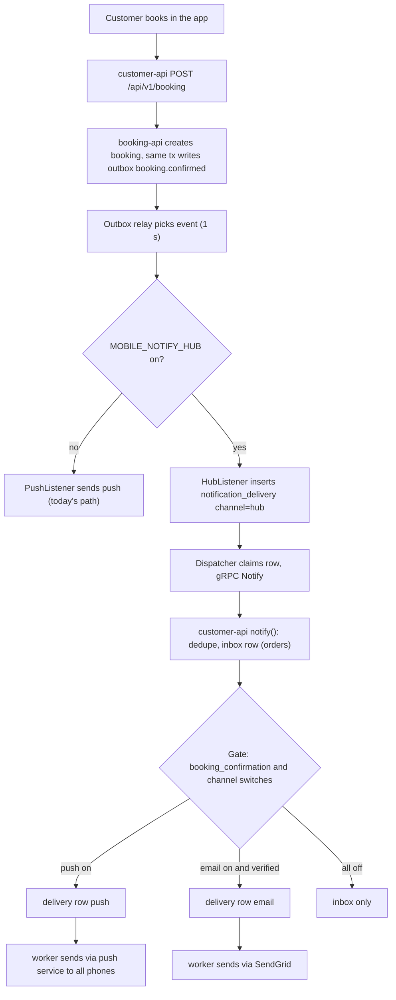

### 2. Appointment reminder scheduling

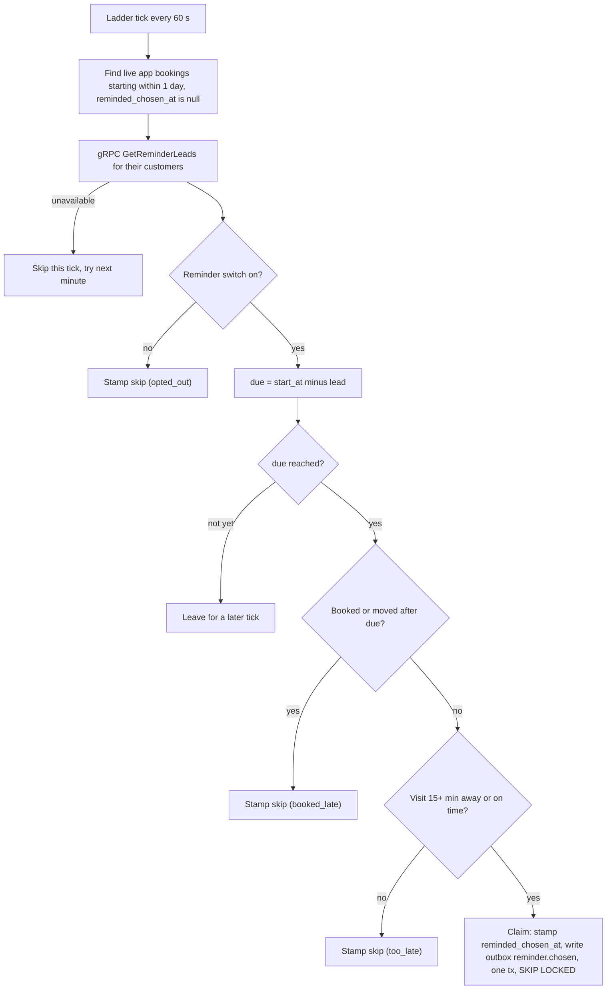

### 3. Appointment reminder delivery

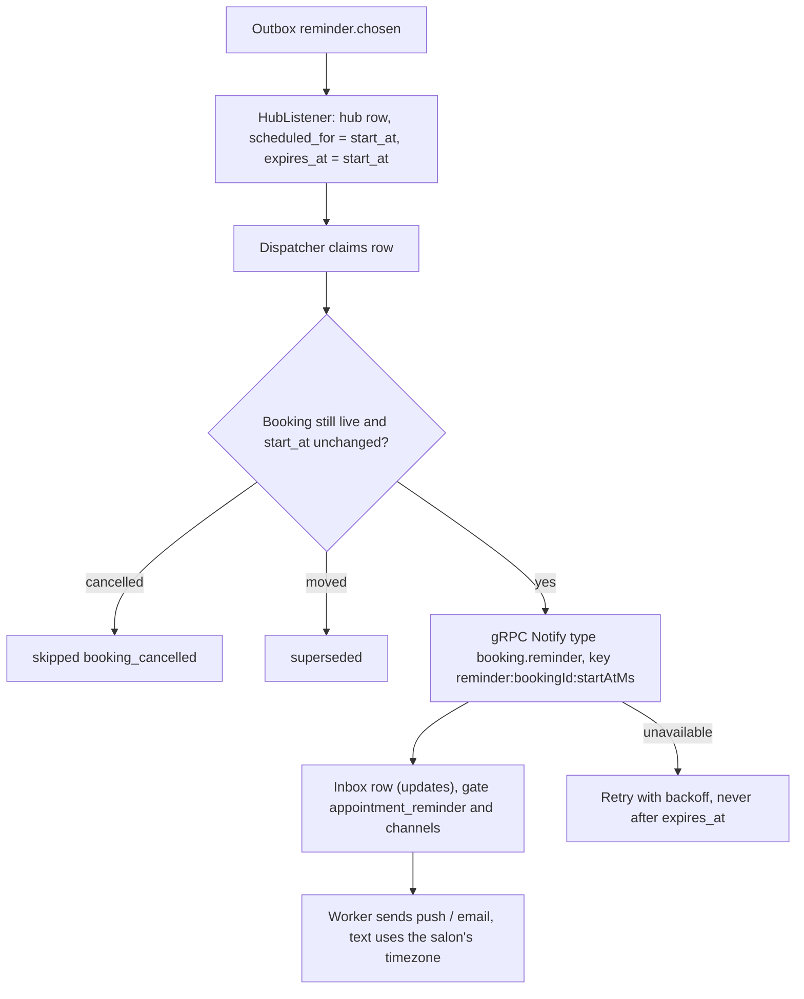

### 4. Booking reschedule and cancel

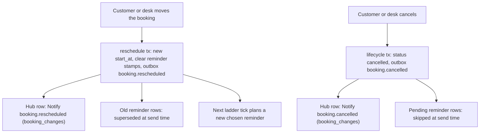

### 5. Payment completed

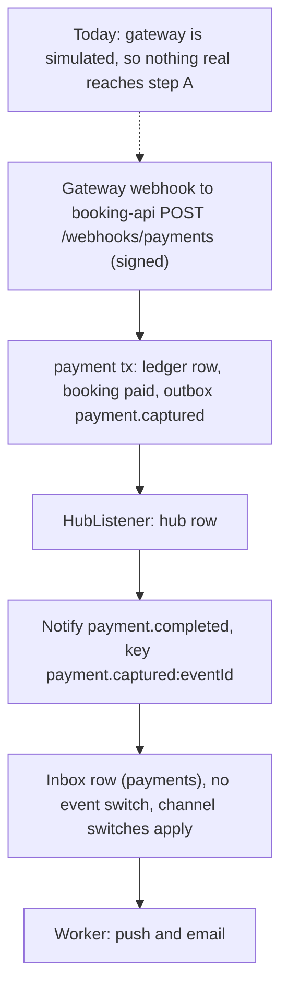

### 6. Payment refund

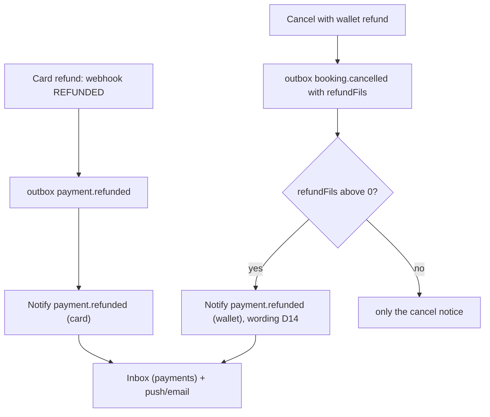

### 7. Order status (no source today)

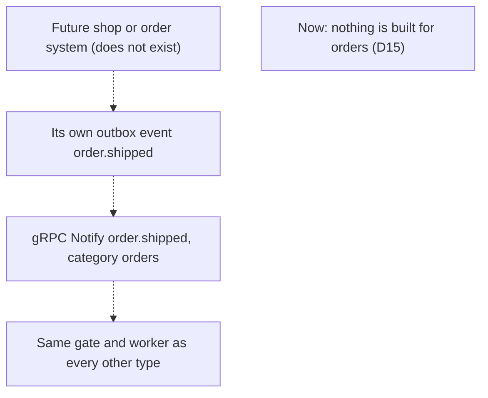

### 8. Promotional notification (later, D16)

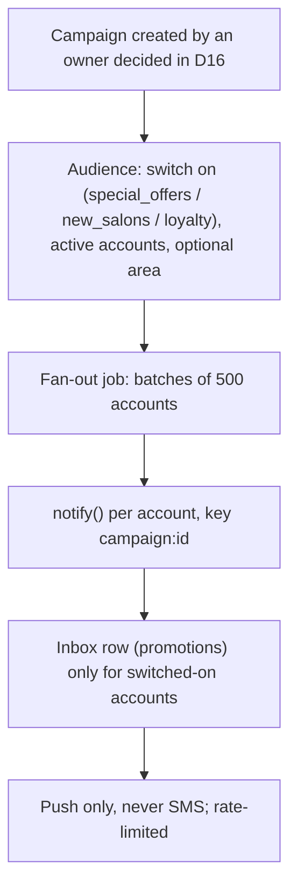

### 9. Preference validation (the gate)

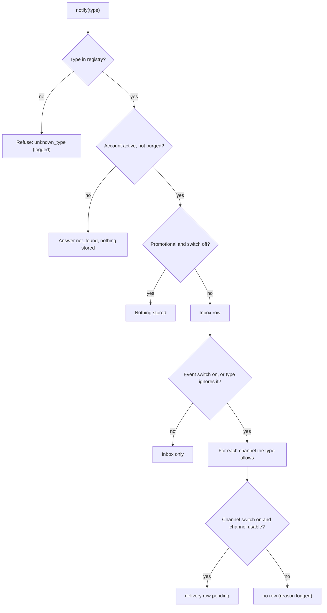

### 10. Push / email / SMS delivery and retry

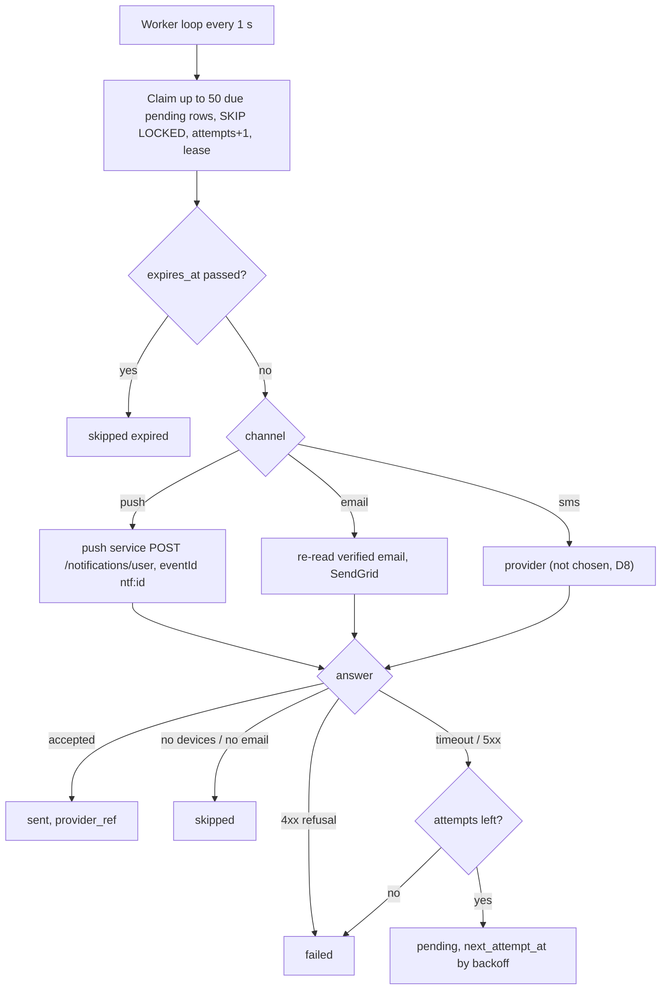

## 2.16 Options considered and not chosen

| Option | Why not |
| --- | --- |
| Make push-notification-service the inbox | It is a generic, per-device, push-only service with one shared key; history is missing when a user has no phone; email-only items would never show. |
| New notification microservice | A seventh deployable to run and secure for what customer-api can do with one more process. |
| booking-api keeps sending push/email and only records to the inbox | Two gates (TypeScript and Python) that drift; SMS and i18n built twice; account and promotion messages still need a sender in customer-api. |
| Reminder scheduler in customer-api | Copies booking-api's tested ladder; customer-api cannot see booking times without events that may arrive late or out of order. |
| Celery / RQ / BullMQ in customer-api | New dependency and a broker; `SKIP LOCKED` polling is already the company pattern and Postgres is the source of truth anyway. |
| WebSockets for the center | New library (ASGI), new auth path; push + refresh covers the screens shown. |

---

# Document 3: Database Design

All new customer-api tables live in the `consumer` schema and are created by
Django migrations (applied when the container starts). booking-api changes are
Prisma migrations run as the separate migrate job. Every new column uses
`db_default` (customer-api) or a SQL default (booking-api), so the image before
the change can still insert rows (safe rollback).

## 3.1 customer-api

### `notification` (new, `apps/notifications.Notification`)

| Field | Type | Notes |
| --- | --- | --- |
| `id` | uuid PK | `uuid4`, like every table here |
| `account_id` | uuid FK `consumer_account` | `ON DELETE CASCADE` |
| `category` | varchar(20) | `orders`, `updates`, `payments`, `promotions`; CHECK constraint |
| `type` | varchar(64) | registry key, e.g. `booking.confirmed`; not a DB enum, so a new type needs no migration |
| `title` | varchar(140) | stored as shown, so history does not change when copy changes |
| `body` | varchar(1000) | |
| `data` | jsonb default `{}` | booking_id, booking code, salon_id, start_at, amount, currency |
| `target_type` | varchar(30) null | `booking`, `booking_group`, `salon`, `session`, `payment`, `offer`, `export` |
| `target_id` | varchar(64) null | |
| `source` | varchar(30) | `booking-api`, `customer-api`, later `platform` |
| `dedupe_key` | varchar(200) | producer's idempotency key |
| `occurred_at` | timestamptz | when the thing happened (sort key for display) |
| `created_at` | timestamptz default now() | |
| `read_at` | timestamptz null | null = unread |
| `expires_at` | timestamptz null | offers only; hidden from the list after it |

Constraints and indexes:

- `UNIQUE (account_id, dedupe_key)` name `notification_account_dedupe_uq`.
- Index `(account_id, created_at DESC, id DESC)` for the list.
- Index `(account_id, category, created_at DESC, id DESC)` for a tab.
- Partial index `(account_id, category) WHERE read_at IS NULL` for counts.
- Index `(created_at)` for the retention delete.

Retention: delete rows older than 180 days (D10), 5,000 per batch, nightly in
the worker.

### `customer_notification_delivery` (new)

Not `notification_delivery`: that name is booking-api's reminder table, which
`apps/booking_data` mirrors read-only in this project.

| Field | Type | Notes |
| --- | --- | --- |
| `id` | uuid PK | |
| `notification_id` | uuid FK | `ON DELETE CASCADE` |
| `channel` | varchar(10) | `push`, `email`, `sms` |
| `status` | varchar(12) | `pending`, `sent`, `failed`, `skipped` |
| `attempts` | smallint default 0 | counted at claim |
| `next_attempt_at` | timestamptz default now() | also the lease |
| `expires_at` | timestamptz null | never send after this |
| `last_error` | text null | trimmed, no personal data |
| `skip_reason` | varchar(40) null | `no_devices`, `email_unverified`, `opted_out`, `expired` |
| `provider_ref` | varchar(200) null | push device count, SendGrid message id |
| `sent_at` | timestamptz null | |
| `created_at`, `updated_at` | timestamptz | |

- `UNIQUE (notification_id, channel)`.
- Partial index `(next_attempt_at) WHERE status = 'pending'`.
- Retention: goes with its notification (cascade).

### `notification_preference` (existing, 3 new columns)

| Field | Type | Default | Notes |
| --- | --- | --- | --- |
| `email` | boolean | true (`db_default`) | channel switch (D7) |
| `sms` | boolean | false (`db_default`) | channel switch (D7, D8) |
| `reminder_lead_minutes` | smallint | 1440 (`db_default`, D5) | CHECK in (30, 60, 120, 1440) |

No backfill: the row is still created lazily; existing rows get the defaults
from the column default. `whatsapp_booking_updates` stays as is (D8).

### `consumer_account` (existing, 2 new columns)

| Field | Type | Default | Notes |
| --- | --- | --- | --- |
| `show_name_to_salons` | boolean | true (`db_default`) | D11 |
| `show_photo_in_moments` | boolean | false (`db_default`) | D12, privacy by default |

Same place as `sign_in_alerts` (`models.py:110`), the existing per-account
setting. `purge()` resets both to defaults.

### `data_export_request` (new)

| Field | Type | Notes |
| --- | --- | --- |
| `id` | uuid PK | |
| `account_id` | uuid FK | `ON DELETE CASCADE` |
| `status` | varchar(10) | `pending`, `running`, `ready`, `failed`, `expired` |
| `requested_at`, `started_at`, `finished_at` | timestamptz | |
| `attempts` | smallint | |
| `next_attempt_at` | timestamptz | lease, as above |
| `file_key` | varchar(300) null | private S3 key, never a public URL |
| `size_bytes` | bigint null | |
| `expires_at` | timestamptz null | file deleted at this time (7 days) |
| `last_error` | text null | |

- Partial unique `(account_id) WHERE status IN ('pending', 'running')`.
- Rows kept 90 days after `expires_at` (to answer "when did I ask?"), then
  deleted.

## 3.2 booking-api (Prisma)

| Change | Detail |
| --- | --- |
| `booking.reminded_chosen_at` timestamptz null | stamp for the chosen rung, cleared by both reschedule paths |
| `booking.reminder_lead_min` smallint null | the lead used at claim (audit and copy) |
| partial index `booking_chosen_rung_idx` on `(start_at)` WHERE `reminded_chosen_at IS NULL AND status IN ('confirmed','pending_payment')` | claim query |
| enum `notification_channel` add value `hub` | `ALTER TYPE ... ADD VALUE` (its own migration; Postgres cannot use a new enum value in the same transaction that adds it) |
| `notification_delivery` rows for non-reminder events | no schema change: `booking_id`, `scheduled_for` (= booking start), `expires_at` (= created + 24 h for non-reminders) all fit. The "superseded" check must apply to reminder types only (code change). |

## 3.3 push-notification-service

- Merge `feat/device-session-id`: `devices.session_id uuid null` + partial index
  (raw DDL at boot, as the service does today).
- No inbox columns. It stays a send log with its 90-day clean-up.

## 3.4 No change

- gostyle-platform: none for phases 1 to 6. Promotions (phase 8) may need
  outbox events on storefront publish and offer create, owned by the platform
  team.
- payment-service: none.

## 3.5 Consistency rules

- An inbox row and its delivery rows are created in **one transaction**.
- A delivery row is never created without its inbox row (FK).
- booking-api never stores customer preferences; customer-api never stores
  booking times (only copies inside `data` for display).
- Purge (account deletion) deletes the account's notifications, deliveries and
  export files in the same job that anonymises the account.

---

# Document 4: API Specification

## 4.0 Conventions (all existing)

- Base: `https://api.gostyle.uk/api/v1/`. No version change.
- Auth: `Authorization: Bearer <access token>` (SimpleJWT, session-checked).
  The user always comes from the token, never from the body or path.
- Errors: `{"detail": "...", "code": "...", "errors": [{"field": ..., "message": ...}]}`.
  Validation is **422** everywhere, except `/notifications/preferences`, which
  keeps its documented **400**.
- Someone else's id answers **404** (never 403), so ids cannot be probed.
- New routes are behind a switch. Off, the route answers the 404 it answered
  before (the pattern used for every feature since `SINGLE_BOOKING_ACTIONS_V1`).
  Switches: `NOTIFICATION_CENTER_V1`, `NOTIFICATION_CHANNELS_V1`,
  `REMINDER_TIMING_V1`, `PRIVACY_SETTINGS_V1`, `DATA_EXPORT_V1`.
- Rate limits use the existing Redis helper (`apps/accounts/ratelimit.py`).

## 4.1 List notifications

`GET /api/v1/notifications`

- Auth: signed in (`IsAuthenticated`). Own items only.
- Query:

| Param | Type | Rule |
| --- | --- | --- |
| `category` | string | `all` (default), `orders`, `updates`, `payments`, `promotions` |
| `unread` | boolean | optional; `true` = unread only |
| `cursor` | string | opaque, from `next` |
| `page_size` | int | 1 to 50, default 20 |

- Sort: newest first (`created_at DESC, id DESC`). Expired offers left out.

```json
{
  "next": "https://api.gostyle.uk/api/v1/notifications?cursor=cD0yMDI2LTEw...",
  "previous": null,
  "results": [
    {
      "id": "0b9c3f6e-6a0e-4c8e-9a51-2f7f0e2f9d10",
      "category": "payments",
      "type": "payment.refunded",
      "title": "Payment refunded",
      "body": "AED 120.00 was refunded for booking GS-4K2P.",
      "is_read": false,
      "read_at": null,
      "created_at": "2026-10-31T09:12:44Z",
      "occurred_at": "2026-10-31T09:12:40Z",
      "target": {"type": "booking", "id": "5f1c...e2"},
      "data": {"booking_code": "GS-4K2P", "salon_id": "a8d0...", "amount": "120.00", "currency": "AED"}
    }
  ]
}
```

- Empty: `200` with `"results": []`.
- Errors: `401` no token; `422` bad `category`, `unread` or `page_size`
  (`code: validation_error`); a broken cursor is `422 invalid_cursor`.
- Grouping (Today, Yesterday, This week, Earlier): done by the app from
  `created_at` in the phone's zone.

## 4.2 Notification detail

`GET /api/v1/notifications/{id}`

- Auth: signed in. Same item shape as the list. Does **not** mark it read (the
  app calls 4.3 when it opens it, so a prefetch cannot mark items read).
- Errors: `404 not_found` (unknown, someone else's, or not a UUID).

## 4.3 Mark one read

`POST /api/v1/notifications/{id}/read`

- Auth: signed in. No body. Idempotent: already read keeps its first `read_at`.
- `200` with the item. Errors: `404`.

## 4.4 Mark all read

`POST /api/v1/notifications/read-all`

```json
{"category": "payments", "before": "2026-10-31T09:12:44Z"}
```

- Both optional. `category` default `all`. `before`: only items created at or
  before this time (the newest the app has shown), so an item that arrives
  while the user taps stays unread.
- `200` `{"updated": 4, "unread": {"total": 2, "orders": 1, "updates": 1, "payments": 0, "promotions": 0}}`
- Errors: `422` bad category or time. Rate limit 30 a minute per account (`429`).

## 4.5 Unread count

`GET /api/v1/notifications/unread-count`

```json
{"total": 3, "orders": 1, "updates": 2, "payments": 0, "promotions": 0}
```

- Auth: signed in. Cheap (partial index). Errors: `401`.

## 4.6 Get notification preferences (extended)

`GET /api/v1/notifications/preferences` (exists; new fields when
`NOTIFICATION_CHANNELS_V1` / `REMINDER_TIMING_V1` are on)

```json
{
  "booking_confirmation": true,
  "appointment_reminder": true,
  "booking_changes": true,
  "special_offers": false,
  "new_salons": false,
  "loyalty": true,
  "push": true,
  "email": true,
  "sms": false,
  "reminder_lead_minutes": 1440,
  "channels_available": {"push": true, "email": true, "sms": false}
}
```

- `channels_available` is read-only: `email` false when there is no verified
  email; `sms` false when there is no provider or no verified phone. The app can
  grey the switch out.

## 4.7 Update notification preferences (one or many)

`PATCH /api/v1/notifications/preferences` (exists)

```json
{"special_offers": true, "email": false, "reminder_lead_minutes": 60}
```

- Partial; only sent fields change; all-or-nothing in one transaction; only the
  sent columns are written (existing behaviour).
- Validation (400, this endpoint's convention):
  - booleans must be real JSON booleans (existing);
  - unknown keys refused (existing; `email` stops being unknown, so the test
    `test_unknown_field_is_400_and_saves_nothing` needs a new example key);
  - `reminder_lead_minutes` in `30, 60, 120, 1440`, else
    `{"field": "reminder_lead_minutes", "message": "Choose 30, 60, 120 or 1440."}`;
  - `email: true` without a verified email: `code email_not_verified`;
  - `sms: true` without a verified phone: `phone_not_verified`; without a
    provider: `sms_unavailable` (D8);
  - `channels_available` sent back: ignored (read-only), like server fields on
    `/auth/me`.
- `200` with the full object. `401` no token.

## 4.8 Update reminder timing

Same endpoint as 4.7 (one field, `reminder_lead_minutes`). No separate route, so
there is one place for every notification setting. The new time counts for every
future visit within a minute (booking-api reads it each tick); a reminder already
sent is not sent again.

## 4.9 Get privacy settings

`GET /api/v1/me/privacy`

```json
{"show_name_to_salons": true, "show_photo_in_moments": false}
```

- Auth: signed in. `Location access` is not here: it is the phone's permission.

## 4.10 Update privacy settings

`PATCH /api/v1/me/privacy`

```json
{"show_name_to_salons": false}
```

- Partial, strict booleans, unknown keys `422`. `200` full object.
- Audit: each change logged as a JSON event (`privacy_setting_changed`, account
  id, field, new value; no names).
- Effect of `show_name_to_salons: false`: new bookings send the short name
  (D11). The response does not promise more than that.

## 4.11 Request a data export

`POST /api/v1/me/data-export`

- Auth: `IsVerified`. When the account has 2-step verification on and
  `TWO_FACTOR_V1` is on, also a verification token for a new purpose
  `data_export` (same flow as the other sensitive changes, `TwoFactorPurpose`
  in `apps/accounts/models.py:591-601`).
- `202`:

```json
{"id": "7c1d...", "status": "pending", "requested_at": "2026-10-31T10:00:00Z"}
```

- Errors: `409 export_in_progress` (one pending or running); `429
  export_too_soon` (one ready in the last 24 h); `403 verification_required`.

## 4.12 Read the latest data export

`GET /api/v1/me/data-export`

```json
{
  "id": "7c1d...",
  "status": "ready",
  "requested_at": "2026-10-31T10:00:00Z",
  "finished_at": "2026-10-31T10:02:13Z",
  "expires_at": "2026-11-07T10:02:13Z",
  "download_url": "https://<private bucket>/exports/7c1d...zip?X-Amz-Expires=600&...",
  "size_bytes": 48211
}
```

- `download_url` only when `ready`, freshly pre-signed for 10 minutes on every
  read. `404` when the account never asked.

## 4.13 Existing, unchanged

- `POST /api/v1/me/device-tokens`, `DELETE /api/v1/me/device-tokens`.
- `GET/PATCH /api/v1/auth/me` (keeps `whatsapp_booking_updates`).
- `GET/PATCH /api/v1/me/security` (keeps `sign_in_alerts`).

## 4.14 Internal gRPC (customer-api :50051, `x-internal-key`)

New `proto/customer_notifications.proto`, served by the existing `grpcserver`:

```proto
service CustomerNotifications {
  rpc Notify (NotifyRequest) returns (NotifyReply);
  rpc GetReminderLeads (GetReminderLeadsRequest) returns (GetReminderLeadsReply);
}

message NotifyRequest {
  string consumer_id = 1;
  string type = 2;            // registry key, e.g. "booking.confirmed"
  string dedupe_key = 3;      // producer's idempotency key
  string occurred_at = 4;     // RFC 3339
  map<string, string> params = 5;  // booking_code, salon_id, start_at, amount, currency, ...
  string target_type = 6;
  string target_id = 7;
  string source = 8;          // "booking-api"
}

message NotifyReply {
  enum Outcome { ACCEPTED = 0; DUPLICATE = 1; NOT_FOUND = 2; SUPPRESSED = 3; }
  Outcome outcome = 1;
  string notification_id = 2;
}

message GetReminderLeadsRequest { repeated string consumer_ids = 1; }  // up to 1000
message ReminderLead { bool enabled = 1; int32 lead_minutes = 2; }
message GetReminderLeadsReply { map<string, ReminderLead> leads = 1; }  // missing id = no account
```

- Unknown type: `INVALID_ARGUMENT` (a bug, not retried). Database down:
  `UNAVAILABLE` (retried).
- The hub renders title and body from `type` + `params` in the customer's
  `language` (English first), so wording lives in one place.
- `ConsumerDirectory.GetConsumerContact` (existing) gains
  `booking_confirmation = 9`, `booking_changes = 10`, `email_enabled = 11`,
  `reminder_lead_minutes = 12`, `display_name = 13` (the short name when
  `show_name_to_salons` is off). Additive fields; old callers keep working.

## 4.15 Push payload contract (for the app)

Every hub push sends `data` (all strings, as FCM requires):

| Key | Example |
| --- | --- |
| `notificationId` | `0b9c3f6e-...` |
| `type` | `booking.reminder` |
| `category` | `updates` |
| `targetType` | `booking` |
| `targetId` | `5f1c...` |

The old booking-api keys (`bookingId`, `code`, `startAt`) are kept while both
paths exist, so the current app build keeps working.

---

# Document 5: Implementation Roadmap

Order chosen so each phase ships alone, behind a switch that is OFF, and the
riskiest booking-api change comes after the customer-api side is proven.
booking-api phases follow the business-web rules: separate PRs from customer-api,
additive only, switch OFF, Rafa checks the business web after each deploy.

## Phase 0: Fix what is already wrong (small, independent)

| | |
| --- | --- |
| What | (a) Confirm `PAYMENT_WEBHOOK_SECRET` is set on booking-api; remove the hard-coded fallback so an unset secret refuses every webhook. (b) Merge push `feat/device-session-id` and deploy push service; check `unregister-session` answers. (c) push service: `removeOnComplete/removeOnFail`, timing-safe key compare. (d) Confirm `BRANCH_TIMEZONE=Asia/Dubai` on booking-api. (e) Schedule `purge_due_accounts` (today nothing runs it). |
| Files | booking-api `src/infrastructure/payments/simulated-gateway.ts`; push `src/notification/notification.module.ts`, `send-user-notification.handler.ts`, `presentation/api-key.guard.ts` |
| Migrations | push: session_id DDL from the branch |
| Depends on | Live checks |
| Tests | booking-api webhook spec: no secret = 401; push: guard spec, job options spec |
| Done when | Webhook refuses unsigned calls live; a signed-out session's token is gone (push `devices` row deleted); live checks answered |

## Phase 1: Honour the switches that already exist (quick win)

| | |
| --- | --- |
| What | booking-api `PushListener` checks `booking_confirmation` (for confirmed), `booking_changes` (cancelled, moved) and `push` before sending; stop "Booking confirmed" for `pending_payment` bookings. Behind `MOBILE_PUSH_PREFS` (off). |
| Files | customer-api `proto/consumer_directory.proto`, `apps/grpc_gen/*_pb2*.py` (regenerated), `apps/grpc_gen/servicer.py:138-170`. booking-api `proto/consumer_directory.proto`, `src/infrastructure/grpc/grpc-customer-contact.ts`, `src/application/ports/customer-contact.port.ts`, `src/infrastructure/messaging/push-listener.ts` |
| Migrations | none |
| Depends on | nothing |
| Tests | customer-api servicer tests for new fields and defaults; booking-api push-listener spec: each switch off = no send; unreachable = defaults |
| Done when | Turning "Booking confirmation" off in the app stops that push on a live phone |

This logic moves into the hub in phase 4; it is kept tiny on purpose.

## Phase 2: Inbox, worker and read APIs (customer-api)

| | |
| --- | --- |
| What | `apps/notifications` app: models, registry, `notify()`, gate, worker command, senders (push), list / detail / read / read-all / unread-count. customer-api's own sign-in push goes through `notify()`. Worker service in compose. Switch `NOTIFICATION_CENTER_V1`. |
| Modify | `config/settings/base.py` (INSTALLED_APPS, switch), `config/urls.py`, `apps/accounts/notifications.py:316-351` (`send_new_sign_in_push` calls `notify()`), `docker-compose.yml` (worker), `config/openapi_flow.py`, `docs/` FE guide |
| New | `apps/notifications/{models,registry,service,gate,senders,worker,views,serializers,urls,admin}.py`, `management/commands/notification_worker.py`, migrations, tests |
| Migrations | `notification`, `customer_notification_delivery` (new tables only) |
| Depends on | Phase 0 (b) for clean multi-device behaviour |
| Tests | unit: registry, gate matrix, dedupe, cursor paging, read-all `before`; DB: unique constraints, `SKIP LOCKED` claim with two workers (two connections in one test), fence on attempt; API: auth, other user's id = 404, empty list, counts; failure: push timeout = retry, 4xx = failed, `devices: 0` = skipped |
| Done when | A sign-in on phone B creates an inbox item, phone A gets the push, the center shows it, read and counts work; worker restart mid-send does not double-send |

## Phase 3: Channels and reminder timing settings (customer-api)

| | |
| --- | --- |
| What | `email`, `sms`, `reminder_lead_minutes` on preferences, `channels_available`; email sender in the worker; `GetReminderLeads` gRPC. Switches `NOTIFICATION_CHANNELS_V1`, `REMINDER_TIMING_V1`. |
| Modify | `apps/accounts/models.py:423-469`, `notification_serializers.py`, `notification_views.py`, `apps/grpc_gen/servicer.py`, `apps/accounts/management/commands/grpcserver.py`, `tests/test_notification_preferences.py` |
| New | `proto/customer_notifications.proto` + generated code, servicer, email sender |
| Migrations | 3 columns with `db_default` |
| Depends on | Phase 2 |
| Tests | validation (each 400 case), verified email / phone rules, defaults for old rows, gRPC batch of 1,000 ids, missing ids, bad UUIDs |
| Done when | The app can change channels and timing; `GetReminderLeads` answers from the server; old app build still works |

## Phase 4: booking-api hands events to the hub

| | |
| --- | --- |
| What | `hub` channel; `HubListener`; dispatcher calls `Notify`; with `MOBILE_NOTIFY_HUB` on, `PushListener`, `CheckInPushListener` and reminder push/email rows step aside for app bookings. Check-in, confirmed, cancelled, moved go through the hub. The hub renders the text with the salon's timezone. |
| Modify | booking-api `prisma/schema.prisma` (enum), `src/infrastructure/persistence/persistence.module.ts` (chain), `src/infrastructure/messaging/reminder-delivery-listener.ts`, `src/application/commands/dispatch-reminders.handler.ts`, `src/domain/booking/reminder-delivery.ts` (superseded only for reminders), `src/infrastructure/grpc/*`, `docker-compose.yml` (switch) |
| New | `src/infrastructure/messaging/hub-listener.ts`, `src/infrastructure/grpc/grpc-customer-notifications.ts`, `proto/customer_notifications.proto`, specs |
| Migrations | `ALTER TYPE notification_channel ADD VALUE 'hub'` |
| Depends on | Phases 2, 3 live |
| Tests | listener spec (switch on/off, desk booking untouched), dispatcher spec (NOT_FOUND skip, UNAVAILABLE retry, DUPLICATE = sent), end-to-end with local customer-api: book, move, cancel = 3 inbox items, 3 pushes, no duplicates after relay replay |
| Done when | On live with the switch on: book / move / cancel each produce one inbox item and one push; switch off = today's behaviour exactly; business web checked by hand |

## Phase 5: Chosen reminder time

| | |
| --- | --- |
| What | `chosen` rung, planner step, late rules (D6), fixed rungs off for app bookings when on (D4). Switch `MOBILE_REMINDER_CHOICE`. |
| Modify | booking-api `src/domain/booking/reminders.ts`, `src/infrastructure/persistence/reminder.repository.ts`, `reschedule.repository.ts` (clear new stamp), `reminder-scheduler.service.ts`, `reminder-health.ts` |
| New | specs; a SQL proof script like `prisma/proof-reminder-delivery.sql` |
| Migrations | 2 booking columns + partial index |
| Depends on | Phase 4 |
| Tests | timing table: each lead x {booked early, booked inside window, moved, cancelled, setting changed before / after due, customer-api down}; clock-controlled tests; two ladder replicas claim once; timezone text for Dubai and a non-UAE zone |
| Done when | A test booking with "30 minutes before" gets exactly one reminder at about start minus 30 min on a live phone; moving it gives a fresh one; cancelling gives none |

## Phase 6: Payments tab

| | |
| --- | --- |
| What | `payment.captured` and `payment.refunded` to the hub; wallet refund from `booking.cancelled.refundFils` (wording D14). |
| Modify | booking-api `hub-listener.ts` (event map); customer-api `registry.py` |
| Migrations | none |
| Depends on | Phase 4; a real gateway for "completed" to mean anything (today simulated) |
| Tests | signed webhook in, one inbox item out; replayed webhook = no second item |
| Done when | A simulated capture and refund each show once in Payments |

## Phase 7: Privacy & Visibility, Download my data

| | |
| --- | --- |
| What | privacy columns + `GET/PATCH /me/privacy`; short-name rule in `customer_sync` and `GetConsumerContact`; export request, worker job, private S3, email + inbox item, purge clean-up; booking-api internal read route for one customer's bookings (separate PR, service key, read-only). |
| Modify | `apps/accounts/models.py`, `serializers.py`, `urls.py`, `views.py`, `apps/salons/customer_sync.py:54-59, 62-109`, `apps/grpc_gen/servicer.py`, `ConsumerAccount.purge`, `config/settings/base.py` (private export bucket/prefix) |
| New | `apps/notifications/export.py` (or `apps/accounts/data_export.py`), views, tests |
| Migrations | 2 account columns, `data_export_request` |
| Depends on | Phase 2 (worker); D11, D12, D13 |
| Tests | privacy validation; sync writes short name when off; export contains every section, nothing of another account; link expires; second request 409/429; purge deletes the file |
| Done when | Export zip downloads on a phone; turning the name off shows "Sara K." on a new booking at the desk |

## Phase 8: Promotions, SMS, Orders (blocked)

Blocked on D8, D15, D16. When unblocked: campaign table and fan-out job in
customer-api, platform outbox events for storefront publish and offers (platform
team), push service concurrency raised and rate-limited, SMS provider adapter.

## 5.1 Testing strategy (all phases)

| Kind | How | Where |
| --- | --- | --- |
| Unit | registry, gate matrix (every type x every switch x every channel), backoff, late-reminder rules, copy rendering | Django `TestCase`; booking-api vitest |
| Integration | `notify()` with a real Postgres: one transaction, rollback leaves nothing | Django `TransactionTestCase` |
| API | each endpoint: 200, 401, 404 for another user's id, 422/400 cases, empty states, switch off = 404 | DRF `APITestCase` |
| Database | unique constraints, partial indexes used (`EXPLAIN` in a test), migrations forward and backward | Django tests + `makemigrations --check` (CI already) |
| Queue / worker | two workers on two connections claim disjoint rows; lease expiry re-delivers; fence stops a late write-back | `TransactionTestCase` with threads |
| Scheduling | fake clock: each lead, booked late, moved, cancelled, setting changed | booking-api vitest with a controlled clock |
| Timezone | rendered time for `Asia/Dubai`, `Europe/London` (DST), a null branch timezone | both repos |
| Duplicates | replay the same outbox event, the same `Notify`, the same push eventId: one item, one push | both repos + a fake push app (the scratchpad `fake-push.mjs` approach used for check-in push) |
| Preferences | switch off per event and per channel; unreachable customer-api | both |
| Channel failures | push 5xx, timeout, 4xx, `devices: 0`; SendGrid 4xx; unverified email | customer-api with `push_api` and email backend mocked |
| Cancel / reschedule | booking-api specs + one local end-to-end run | booking-api |
| Authorization | another account's notification id, export id; internal gRPC without key = UNAUTHENTICATED | both |
| End-to-end | on live with a test account and a real phone, one curl at a time (Rafa's way): book, move, cancel, reminder, read, read-all, count | server |

---

# Document 6: Risks and Recommendations

## 6.1 Live problems found during the audit

| # | Severity | Problem | Evidence | Fix |
| --- | --- | --- | --- | --- |
| R1 | High (if the secret is unset) | booking-api's public `POST /webhooks/payments` checks an HMAC whose secret falls back to the fixed string `simulated-webhook-secret`. `PAYMENT_WEBHOOK_SECRET` is not in `docker-compose.yml`. If unset live, anyone can mark a booking paid or refunded. | `src/infrastructure/payments/simulated-gateway.ts:28-30`, `webhooks.controller.ts:86` (`@Public()`) | Phase 0 (a), check today |
| R2 | Medium | Booking confirmed / cancelled / moved pushes ignore every customer switch, including the push master switch. | `push-listener.ts:61-85` | Phase 1 |
| R3 | Medium (privacy) | Signing a device out may not remove its push token: the push route is on an unmerged branch, and customer-api treats a 404 as done. A signed-out phone would keep showing the account's notifications. | push `feat/device-session-id` not in imransid/main; `apps/accounts/sessions.py:631-660` | Phase 0 (b), check live |
| R4 | Medium | "Booking confirmed" is pushed for `pending_payment` bookings (unpaid); a routine sends one "confirmed" per visit. | `booking.repository.ts:635-646, 344-360`; `mobile-series.handler.ts:1435` | Phase 1 / 4 |
| R5 | Medium | booking-api `BRANCH_TIMEZONE` defaults to `Asia/Dhaka`; reminder text shows the wrong hour. **Seen live 2026-10-31**: the quote for an 11:00 Dubai visit answered `13:00+06:00`. | `docker-compose.yml:57` | Phase 0 (d) |
| R6 | Medium | booking-api `PushListener` makes network calls (up to about 10 s with retries) inside the outbox relay's transaction; the relay retries every second with no backoff. | `outbox-relay.service.ts:89-147`, `persistence.module.ts:149-157` | Phase 4 moves sends out |
| R7 | Low | Reminders claimed while `REMINDER_DELIVERY` is off are never sent later. Expected, but worth knowing before switching it on. | `reminder-delivery-listener.ts:56` | Note only |
| R8 | Low | push service: one shared API key for every caller, compared with `!==`; Redis without password; jobs never removed (Redis grows); no rate limit; `docker-stack.yml` stale with password `postgres`. | `api-key.guard.ts:13-15`, `notification.module.ts`, `docker-stack.yml:5,26` | Phase 0 (c); per-caller keys later |
| R9 | Low | `/auth/me` `push_token` reads a customer-api table nothing writes. | `serializers.py:264-270`, `models.py:304-330` | Return null always and document, or drop later (app contract: additive only) |
| R10 | Low | Account purge leaves the customer's name, phone and email in the salon's `public.customer` row. Relevant to privacy and export promises. | `customer_sync.py`; nothing in `apps/accounts` writes `public.customer` | Decide with platform owner |
| R11 | Low | `purge_due_accounts` is not scheduled, so deletions never complete. | `apps/accounts/management/commands/purge_due_accounts.py`; no cron or scheduler in `docker-compose.yml` | Phase 0 (e) / worker |
| R12 | Info | `customer_sync` caches one platform customer id per account, so a second salon likely gets no customer row of its own. | `customer_sync.py:62-67, 98-109` | Separate ticket |
| R13 | High (if it repeats) | **Seen live 2026-10-31**: `POST /auth/2fa/send` answered `500` (HTML) for an account with 2-step on. Likely SendGrid refusing the email: the send runs in `on_commit` with `fail_silently=False` and nothing catches it. A customer with 2-step by email may not be able to sign in. | `apps/accounts/two_factor.py:296-302`, `notifications.py:47-78` | Check the server log, then a small fix |

## 6.2 Architectural risks of this plan

| Risk | Mitigation |
| --- | --- |
| customer-api becomes a single point for all customer messages | It already is for auth (every booking-api customer call verifies through its gRPC). Worker and gRPC are separate processes; the API keeps answering if the worker stops. Reminders wait (retry) instead of being lost. |
| gRPC server is 1 replica, no TLS | Already the case for auth. Overlay network only, internal key. Can go to 2 replicas (stateless). |
| Two push paths during the switch-over | One switch per path; the hub uses a different eventId prefix, so a mis-set switch could send twice. Test with both switches in every combination; never run both on for the same event type (the listener checks the switch itself). |
| Reminder lead read every minute from another service | Batch call, memoised per tick; skip on outage (sending would fail anyway). |
| Copy moves from booking-api to customer-api | Port the existing reminder wording as is; snapshot tests compare both renderings before switching. |
| Inbox growth | Retention job; indexes are per account; 180 days. |
| App contract | All changes additive; old push data keys kept; preferences keep their 400 convention. |

## 6.3 Missing infrastructure and external needs

| Need | Status | Who |
| --- | --- | --- |
| SMS provider + credentials | none exists; costs money (D8) | Owner decision |
| WhatsApp booking-update template (if "SMS" means WhatsApp) | not approved; only the OTP template exists | Meta template approval |
| Real payment gateway | booking-api simulated; payment-service not deployed, no AED | Separate project |
| Private S3 location for exports | today's bucket builds public-style URLs | Rafa (AWS) |
| SendGrid sender for notification emails | exists (`noreply@gostyle.uk`) | none |
| booking-api SMTP for reminder emails | live value UNKNOWN | check |
| FCM credentials | exist on the push server (untracked, ignored file) | none |
| Promotion content owner and targeting | not decided (D16) | Product |
| Customer location for "new salons nearby" | not stored; storing it is a privacy change | Product + privacy |

## 6.4 Security checklist for the build

- User comes from the token only; every query filters on `account_id`; other
  ids answer 404.
- Internal gRPC: existing fail-closed `x-internal-key`; `Notify` takes a
  consumer id, so the key must stay secret (it already guards email addresses).
- Push and email text: no amounts on the lock screen if D14 says so, never an
  email address, never a reset link.
- Device tokens never logged in full (first 8 characters at most).
- Export: verified account, 2-step token when on, private object, 10-minute
  pre-signed links, file deleted after 7 days, one per day.
- Rate limits: read-all 30/min, export 1/day, preferences PATCH 60/min, via the
  existing Redis helper.
- Audit: JSON log events for preference changes, privacy changes, export
  requested / downloaded (account id only, no personal data), in Loki like the
  rest.

## 6.5 Recommendations in one list

1. Run the live checks and fix R1 today; it is outside this feature but real.
2. Approve D1 to D7 so phases 0 to 5 can start; D8, D11 to D16 only block their
   own phase.
3. Build in the phase order above; never two switches flipped in one deploy.
4. Keep booking-api's reminder engine; extend it, do not rebuild it.
5. Do not add WebSockets, Celery or a new service for this.
